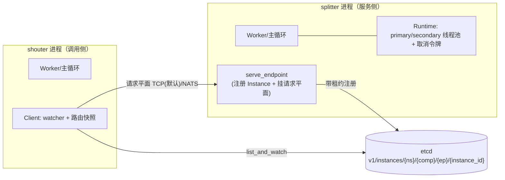

# 第 6 章 · Runtime：组件、端点与命名空间

> **适合谁读**：所有读者（第二部分必读）。
> **前置**：ch05 跑过 hello_world。
> **耗时**：50 分钟
> **源码锚点**：commit `61e9184`（v1.5.0）。

**学完能：**
- 说清 Dynamo 为什么要自建一套"命名 + 注册 + 发现"模型，而不是直接用 HTTP 地址或 K8s Service
- 对 Runtime / DistributedRuntime / Worker / Namespace / Component / Endpoint / Instance / Client 中的每一个，回答四个问题：**为什么引入、起什么作用、在哪定义、谁在用**
- 解释 `namespace.component.endpoint` 三元组如何逐段映射成 etcd 里的 key
- 自己写一个两组件流水线

---

## 6.1 问题先行：这套概念到底在解决什么

回想 ch03 的架构图：Dynamo 把一次 LLM 推理拆成 frontend、router、prefill worker、decode worker 等多个**进程**，它们可能分布在不同机器、不同容器里，而且成员随时变化——K8s 会扩缩容，进程会崩溃重启。于是任何两个进程要协作，都必须先回答三个问题：

1. **你是谁？** 我要调用的"decode worker 的 generate 入口"此刻有哪些活着的副本？
2. **你在哪？** 每个副本的实际地址（TCP 端点或 NATS subject）是什么？
3. **你没了怎么办？** 副本崩溃后，调用方多快能知道、怎么知道？

三种常见做法都不够用：

- **写死地址 / 环境变量传地址列表**：扩缩容要改配置重启调用方；进程崩溃靠人工摘除。
- **中心负载均衡器（如普通 K8s Service）**：只给出"一个稳定虚拟 IP"，调用方**看不到实例集合**。但 Dynamo 的 KV-aware 路由（ch10–ch12）恰恰要求按"哪个 worker 缓存了这段 prefix"来挑实例，负载均衡器把实例藏起来等于废掉了这个能力。
- **DNS 轮询**：同样拿不到实例级元数据，且刷新是分钟级。

Dynamo 的选择：**名字是第一公民，调用方只写名字；一个外部注册表（默认 etcd）做名字→地址的真相源；注册表的变化通过 watch 推送给调用方**。本章的所有概念，都是围绕这个选择长出来的骨架——每一个都对应上面某个问题的某一部分。

先给全章地图，后面逐节展开：

| 概念 | 回答的问题（为什么引入） | 定义位置（Rust） | 生产使用方举例 |
|------|--------------------------|------------------|----------------|
| `Runtime` | 进程内的异步资源（线程池、取消令牌）归谁管 | `lib/runtime/src/runtime.rs` | 所有 Rust 入口的底座 |
| `DistributedRuntime` | 进程与集群的关系（发现、传输）谁持有 | `lib/runtime/src/distributed.rs` | Python `DistributedRuntime` 的真身 |
| `Worker` | 用户代码怎么跑起来、怎么优雅退场 | `lib/runtime/src/worker.rs` | 每个服务的 main |
| `Namespace` | 多套部署共用一个 etcd 时怎么隔离 | `lib/runtime/src/component.rs` | DGD 部署的 namespace（ch20） |
| `Component` | 一类进程的角色怎么命名和分组 | `lib/runtime/src/component.rs` | vLLM/SGLang worker、router、planner |
| `Endpoint` | 组件上哪个入口被调用 | `lib/runtime/src/component.rs` | `generate`、`clear_kv_blocks` 等 |
| `Instance` | 一个 endpoint 的某个在线副本 | `lib/runtime/src/component.rs` | **路由的直接对象** |
| `Client` | 调用方句柄：怎么跟住实例集合 | `lib/runtime/src/component/client.rs` | frontend、router |

> **定义位置速记**：`Component`/`Endpoint`/`Namespace`/`Instance` 四个类型全部在 `lib/runtime/src/component.rs`（模块根文件，约 700 行）；`component/` 子目录放的是分关注点的实现——`endpoint.rs` 是服务侧启动链路、`client.rs` 是调用侧、`namespace.rs`/`registry.rs` 是 metrics 挂接与去重注册表、`service.rs` 是遗留 NATS 服务。初读时先读 `component.rs`，再按需钻子目录。

## 6.2 三层运行时：Runtime → DistributedRuntime → Worker

这三个名字最容易混。区分办法：**Runtime 管进程内，DistributedRuntime 管进程与集群之间，Worker 管你的代码**。

### Runtime（本地）—— 为什么要有它

定义：`lib/runtime/src/runtime.rs`，文件头注释第一句就是"Local Runtime … shared resources local to the physical node/machine"。它持有：

- **两个 tokio 线程池**：`primary`（跑业务请求）和 `secondary`（单线程，专跑 etcd lease 续租、watch 等后台任务）。为什么分两个池？lease 心跳必须准点——如果和业务共享线程池，一次长阻塞（比如模型加载）就可能拖迟心跳，etcd 误判进程死亡、删掉注册、整个 worker 被路由摘除。这是"后台任务与业务隔离"的隔离带。
- **取消令牌树**：一个主 `CancellationToken`，`endpoint_shutdown_token` 是它的 child。`shutdown()`（runtime.rs:339）按三阶段执行：先取消 endpoint 令牌（停止收新请求）→ 等优雅关闭追踪器清零（在途请求做完）→ 最后取消主令牌（断开 etcd/NATS 连接）。顺序是刻意的：先关门、再送客、最后拆桥。
- 计算线程池（compute pool）与优雅关闭追踪器（graceful shutdown tracker）。

### DistributedRuntime（分布式）—— 为什么还要再包一层

定义：`lib/runtime/src/distributed.rs`。`Runtime` 只懂线程池，不懂"别的进程"。`DistributedRuntime` 在其上加装进程与集群交互的全部设施：

- **发现客户端** `discovery_client: Arc<dyn Discovery>`（distributed.rs:110）——注意是 trait。默认 etcd，但 `DYN_DISCOVERY_BACKEND` 可选 `kubernetes`（直接 watch K8s API，少部署一个 etcd）、`file`、`mem`（`DistributedConfig::process_local()` 用内存后端，让 frontend+backend 同进程跑，mocker 和测试靠它）。抽象的原因：语义（注册 + list_and_watch）固定，后端按环境替换。
- **请求平面** `NetworkManager`：请求字节走 TCP（默认）还是 NATS，由 `DYN_REQUEST_PLANE` 决定。
- **组件注册表** `component_registry`：后面 6.5 会看到它去重 watcher 的用途。

Python 侧 `from dynamo.runtime import DistributedRuntime` 拿到的就是它的 PyO3 包装（`lib/bindings/python/rust/lib.rs` 里的 `#[pymethods] impl DistributedRuntime`）。所以"Python `DistributedRuntime` 对应 Rust 哪个类型"的答案是 `distributed.rs` 的 `DistributedRuntime`（它内部又持有一个 `runtime.rs` 的 `Runtime` 字段）——两层都要有，缺一不可。

### Worker —— 用户代码的跑道

定义：`lib/runtime/src/worker.rs`。它解决"从 `main()` 到业务协程"之间的全部杂事：

- **进程级单例 tokio runtime**（worker.rs:39 的 `static RT: OnceCell`）。为什么是单例？PyO3 桥需要一个 `&'static` 引用（`ensure_process_runtime` 的注释写明），且一个进程两个 runtime 线程数会翻倍。
- `execute` / `execute_async`：把你的 async 函数放上 runtime 主池运行，并挂好信号处理器（SIGINT/SIGTERM → 触发优雅关闭）。
- **优雅退出的兜底**：收到信号后给应用 `DYN_WORKER_GRACEFUL_SHUTDOWN_TIMEOUT` 秒（debug 默认 5s、release 默认 30s）收尾，超时直接 `std::process::exit(911)`（worker.rs:233）。

Python 里你从不直接碰 `Worker`，因为 `@dynamo_worker()` 装饰器（`lib/bindings/python/src/dynamo/runtime/__init__.py:21`）替你做了：读 `DYN_DISCOVERY_BACKEND`（默认 etcd）和 `DYN_REQUEST_PLANE`（默认 tcp）两个环境变量 → 构造 `DistributedRuntime(loop, …)` → 传给你的函数。这就是 hello_world 里 `async def worker(runtime: DistributedRuntime)` 那个 `runtime` 的来历。

## 6.3 命名三元组：namespace.component.endpoint

`runtime.endpoint("dynamo.backend.generate")`（hello_world 用的 namespace 就叫 `dynamo`）按 `.` 切成三段，这个切分在 PyO3 层完成（`lib.rs` 的 `fn endpoint(path)`：先剥掉可选的 `dyn://` 前缀，再 `namespace().component().endpoint()` 链式构造）。三段各自的存在理由：

| 段 | 为什么需要它 | 定义/构造位置 | etcd 里的体现 |
|----|--------------|----------------|----------------|
| `namespace` | 多套部署共用一个 etcd 时互不干扰；K8s 部署里直接对应 DGD 的 namespace（ch20），这是运维边界与名字边界的重合 | `component.rs` 的 `struct Namespace`；由 `DistributedRuntime::namespace()`（distributed.rs:431）创建；支持嵌套（`parent` 字段，`name()` 会拼出 `parent.child`） | key 的**第一段** |
| `component` | 给"一类进程"一个角色名（frontend、backend、router…）。一个 component 可挂多个 endpoint，共享一个 NATS service（NATS 平面时）和一份 metrics registry | `component.rs` 的 `struct Component`；由 `Namespace::component(name)` 创建，同名的会命中 `component_cache`（DashMap）返回同一实例——避免重复注册 metrics、重复建 NATS service | key 的**第二段** |
| `endpoint` | 精确到"方法级"入口。同一个 vllm worker 上 `generate` 和 `clear_kv_blocks` 是两个 endpoint，各自独立注册、独立被发现 | `component.rs` 的 `struct Endpoint`；由 `Component::endpoint(name)` 创建 | key 的**第三段** |

三段名字都受同一个校验约束：`^[a-z0-9-_]+$`（`component.rs` 底部的 `validate_allowed_chars`）。

**etcd 里的完整形态**（这是 6.4/6.5 两节注册与发现共同依赖的事实）：

```
bucket: v1/instances
key:    {namespace}/{component}/{endpoint}/{instance_id:十六进制}
value:  Instance 的 JSON —— transport 地址、device_type、payload codec
```

key 的拼法来自 `EndpointInstanceId::to_path()`（`lib/runtime/src/discovery/mod.rs:936`）。注意最末段的 `instance_id`：它不是 PID，而是该进程 `DistributedRuntime` 的**发现连接 ID**（`connection_id()`）。这就引出三元组之外的第四个关键概念——

### Instance：路由真正面向的对象

定义：`component.rs:107` 的 `struct Instance`。语义是"**某 endpoint 的一个在线副本**"：8 个 vllm worker 副本 = 同一个三元组下 8 个不同 `instance_id` 的 Instance。它携带 `transport`（TCP 模式形如 `host:port/{instance_id:hex}/{endpoint_name}`，NATS 模式是按实例生成的 subject）、`device_type`、`request_plane_codec`。

为什么要有它：调用方要的从来不是"那个 endpoint"，而是"那个 endpoint 现在活着的**某一个**副本"。KV-aware 路由（ch12）挑的就是 Instance。可以说：**三元组是静态的名字，Instance 是动态的成员**，注册表维护的是后者。

**由此得到本章最重要的性质：调用方只写名字，不写地址。** 地址解析 = 订阅 `v1/instances/{ns}/{comp}/{ep}/` 这个前缀下的 key 集合。加一个 worker 副本 = 多一个 key，调用方代码零改动——这也是 ch20 弹性扩缩容能成立的前提。

## 6.4 服务侧：serve_endpoint 逐步发生了什么

hello_world 服务端（`lib/bindings/python/examples/hello_world/server.py`）就三行有效代码：

```python
@dynamo_worker()
async def worker(runtime: DistributedRuntime):
    endpoint = runtime.endpoint("dynamo.backend.generate")
    await endpoint.serve_endpoint(RequestHandler().generate)
```

两步的副作用边界值得抠清楚：

1. `runtime.endpoint(...)` 只是**构造名字句柄**——按 6.3 的链式调用拼出 `Endpoint` 结构体，不产生任何网络副作用，也不要求对端存在。
2. `serve_endpoint(fn)` 才产生全部副作用。它一路下沉到 Rust 的 `EndpointConfigBuilder::start_with_registration()`（`lib/runtime/src/component/endpoint.rs:133`），按序做四件事：
   - **包 handler**：PyO3 侧（`lib.rs:1445`）把 Python async generator 包成请求平面的 ingress 引擎（普通 handler 走拉模式；TRT-LLM 风格、签名带 `response_sender` 的走推模式），同时把同一个 handler 注册进**本地注册表**（`local_endpoint_registry`）——同进程调用方和健康探针可以直接进程内调用，不走网络；
   - **挂到请求平面服务器**：在本进程的 TCP（或 NATS）服务上注册这个 endpoint 名字的处理入口；
   - **向发现平面注册**：构造 `Instance`（含真实传输地址）写入注册表（etcd 模式下挂在租约下）；
   - **起清理任务**：spawn 一个等 `endpoint_shutdown_token` 的任务，令牌一取消就反注册请求平面 + 反注册发现平面。

   Python 的 `await serve_endpoint(...)` 内部最终 `await` 的是清理任务的 `wait()`——所以这个 await **要到进程关停那一刻才返回**，server.py 的主协程就停泊在这里。

**租约语义**（etcd 后端时）：etcd 客户端建立时创建一条 primary lease（`lib/runtime/src/transports/etcd.rs`：secondary 线程池里专门跑续租任务），lease 与 `Runtime` 生命周期双向绑定——lease 过期 ⇒ runtime 关停；runtime 关停 ⇒ 撤销 lease。所有注册 key 都挂在这条租约下，于是进程被 `kill -9` 后无需任何人做任何事，TTL 一到 key 自动消失，各 watcher 收到删除事件，路由表收缩。**系统里没有"注销"这个显式动作**（例外见下）。

- 例外：组件**休眠而非销毁**的场景（ch20 弹性伸缩里省 GPU），代码里专门提供了 `Endpoint::unregister_endpoint_instance()` / `register_endpoint_instance()`（`component/endpoint.rs:392` 起）——进程活着、只是主动从路由池里摘掉/挂回。日志会明确打出 "worker removed from routing pool"。

生产侧谁在这么用：planner（`components/src/dynamo/planner/__main__.py:40`，`runtime.endpoint(f"{config.namespace}.Planner.generate")` 后紧跟 `serve_endpoint`）、vllm worker（`components/src/dynamo/vllm/worker_factory.py`）、router、kv_state_agent 等所有组件——模式与 hello_world 完全一致，区别只在 handler 里面装了什么。

## 6.5 调用侧：Client 不是"一次解析"

hello_world 客户端（`examples/hello_world/client.py`）：

```python
@dynamo_worker()
async def worker(runtime: DistributedRuntime):
    endpoint = runtime.endpoint("dynamo.backend.generate")  # 同样只是名字句柄
    client = await endpoint.client()

    await client.wait_for_instances()      # 等 watcher 看到至少一个副本
    stream = await client.generate("hello world")  # 发起调用，拿到流
    async for char in stream:              # 注意：先 await 再迭代
        print(char)
```

（对比旧教程常见的 `async for chunk in client.generate(...)`——错，`generate` 是协程，先 `await` 拿到 stream 再迭代。）

`Client` 的定义与全部行为在 `lib/runtime/src/component/client.rs`。它最容易被误解成"构造时做一次地址解析"，实际构造链路（`Client::new` → `with_reconcile_interval_and_cancellation`，client.rs:500 起）是：

1. **获取或共享一个 `EndpointDiscoverySource`**：向发现平面发起 `list_and_watch`，watch `v1/instances` 下该三元组前缀，把实例集合持续写入一个 `tokio::watch` channel。为什么是"获取**或共享**"：同一 endpoint 的多个 Client 共享同一个 watcher（`DistributedRuntime` 的 `component_registry` 负责去重）——控制面的 watch 连接是稀缺资源，8 个调用方不该建 8 条 watch。
2. **维护路由快照 `RoutingInstances`**：把"发现的实例"整理成 discovered / routable / free（free = 排除掉报告过载的）几个集合，随 watch 事件增量更新。
3. 之后每次 `client.generate(...)` 从快照里挑一个 Instance（随机、轮询或 KV-aware，策略见 ch12），向它携带的 transport 地址发起请求平面直连。

所以 Client 的"粘性"粘的是**名字**而不是某个地址：它绑定三元组、持续跟住实例集合；副本扩容 → watch 事件 → 快照增长 → 新请求自动分流过去，全程不需要重建 Client。`wait_for_instances()` 的意义也在此：刚构造时快照可能还是空的，它是"等到第一份非空快照"的同步点。

还有两个容易忽略的细节，后面章节会用到：请求字节走**请求平面**（TCP/NATS，ch07）；而 KV 事件、负载信息走**事件平面**（ZMQ 默认，`DYN_EVENT_PLANE` 可选 NATS）——两个平面是分开的，别混。

## 6.6 一个两组件流水线（练习）

目标：`splitter` 把句子按 `,` 拆词，`shouter` 把每个词大写并流回。这个练习逼你同时站在服务侧和调用侧。骨架（注意真实的调用顺序）：

```python
# splitter.py —— 它在中间，既收也发
from dynamo.runtime import DistributedRuntime, dynamo_worker, dynamo_endpoint

@dynamo_endpoint(str, str)
async def split(request: str):
    for word in request.split(","):
        yield word

@dynamo_worker()
async def worker(runtime: DistributedRuntime):
    ep = runtime.endpoint("pipe.splitter.split")
    await ep.serve_endpoint(split)             # 对上游提供服务（await 到关停）

    # 对下游发起调用（顺序：先 client，再 wait，再调用）
    shout = runtime.endpoint("pipe.shouter.shout")
    client = await shout.client()
    await client.wait_for_instances()
    ...  # 在 split 的 handler 里把每个词转发给 shouter
```

写完 `shouter.py` 后：三个终端分别起 etcd、splitter、shouter，再写个 10 行客户端验证。**验收标准**：把 shouter 进程 Ctrl-C 掉再重启，splitter 的 client 不重建、不停机，自动恢复调用——如果你能解释这中间 watch/lease/快照各发生了什么，本章就算通了。

顺带一提 `@dynamo_endpoint(str, str)` 的两个参数（定义在 `lib/bindings/python/src/dynamo/runtime/__init__.py:54`）：**第一个**是请求模型——仅当它是 `BaseModel` 子类时生效，把线上到达的 `str`/`dict` 载荷解析成类型化对象（传 `str` 这类非 BaseModel 则跳过解析，载荷原样进来）；**第二个**响应模型目前只是声明位，**尚未启用校验**（docstring 明说 "reserved for future validation"）。另外别把它误解成"序列化方式选择"——线上字节用什么编码（msgpack/JSON）由请求平面 codec 决定，装饰器只管入口处的模型解析。

## 6.7 概念总装



一张图对着源码读：左边进程的 `serve_endpoint` 写注册表，右边进程的 `Client` watch 同一张注册表，真实请求字节完全不经过 etcd，走两个进程间的直连。

## 小结

每个概念一句话"为什么"：

- **Runtime**：进程内共享资源（线程池、取消令牌树）需要唯一属主，且后台任务必须和业务隔离（secondary 池保 lease 心跳准点）。
- **DistributedRuntime**：进程与集群的关系（发现、传输、注册表）需要单独一层，Python 的同名类是它的 PyO3 壳。
- **Worker**：用户代码需要跑道（单例 runtime）与退场协议（信号 → 优雅关闭 → 超时 exit 911）。
- **Namespace**：多部署共享一个注册表时的名字隔离边界。
- **Component**：一类进程的角色名，endpoint 的分组单位。
- **Endpoint**：方法级入口，名字三元组的最后一段。
- **Instance**：endpoint 的在线副本，携带真实传输地址——路由直接面向的对象；`kill -9` 后靠租约自动消失。
- **Client**：绑定名字、共享 watcher、跟住实例集合的调用句柄，"粘"名字不粘地址。

## 自检（5 题，自答）

1. 为什么不直接用 K8s Service 做服务发现？（提示：Dynamo 需要的语义是"实例集合的推送流 + 每实例元数据"；`DYN_DISCOVERY_BACKEND=kubernetes` 后端恰恰说明需要的是语义而非 etcd 本身）
2. `runtime.endpoint(...)` 和 `serve_endpoint(...)` 各自产生什么副作用？`await serve_endpoint(...)` 什么时候返回？
3. 进程被 `kill -9`，它的注册记录靠什么机制、在多久之后消失？为什么系统里不需要"注销"这个动作？什么场景下例外？
4. 8 个调用方对同一个 endpoint 各建一个 Client，etcd 上会出现几条 watch？谁保证的？
5. `@dynamo_endpoint(Request, Response)` 两个参数分别约束什么？哪个现在还没生效？线上字节用什么序列化由谁决定？

## 下一步（跳转推荐）

- → [ch07 传输四平面](ch07-transports.md)（etcd/NATS/TCP/ZMQ 各承载什么字节）
- → [ch08 服务发现与 Worker 生命周期](ch08-discovery.md)（`list_and_watch` 与 watcher 如何驱动路由表）
