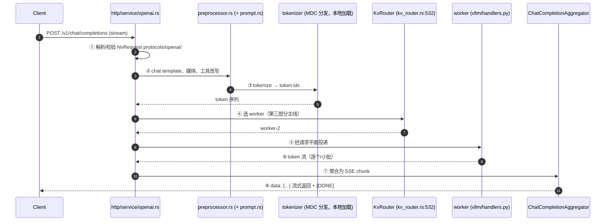
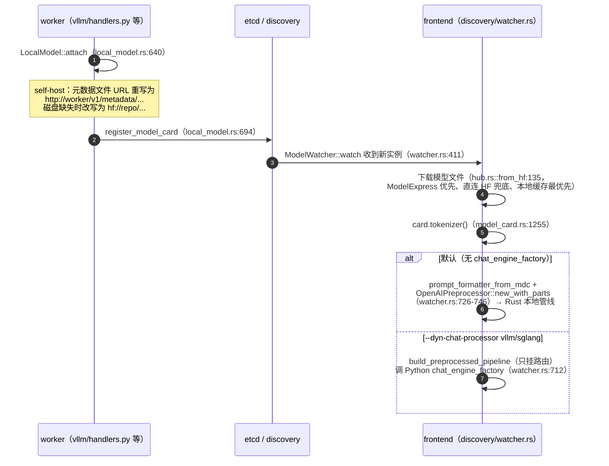

# 第 9 章 · 前端入口：一次 HTTP 请求的完整旅程

> **适合谁读**：所有读者（源码主线第一章）。建议开着编辑器跟读。
> **前置**：ch03、ch06、ch08。
> **耗时**：80 分钟
> **源码锚点**：commit `61e9184`（v1.5.0）。

**学完能：**
- 从 `python -m dynamo.frontend` 开始，逐层指出代码如何走到 Rust HTTP 服务器
- 拆解一次流式 chat completion 经过的前处理、路由、聚合各阶段
- 说清模型卡（MDC）如何从 worker 广播到前端、tokenizer 和 chat template
  如何随之就位（9.3）
- 讲解 Rust 侧 chat template 渲染引擎（MiniJinja）与 tokenizer 后端选择，
  以及 `--dyn-chat-processor vllm/sglang` 的 Python 端前处理何时该用（9.6）
- 知道该在哪些文件下断点/加日志来调试前端行为

---

## 9.1 启动链路：Python 壳 → Rust 芯

```
components/src/dynamo/frontend/__main__.py
  └─ frontend/main.py :: main()                     # 495 行（已核验）
       ├─ uvloop.run(async_main())
       └─ async_main():
            ├─ 构建 DistributedRuntime（PyO3 → lib/runtime）
            ├─ build_router_config(config)           # frontend_args.py
            ├─ EntrypointArgs(EngineType.Dynamic, **kwargs)
            ├─ engine = await make_engine(runtime, e)
            │     └─ lib/bindings/python/rust/llm/entrypoint.rs
            └─ await run_input(runtime, "http", engine)     # 或 "grpc"/"text"
                  └─ lib/llm/src/entrypoint/input.rs
                       └─ lib/llm/src/http/service.rs / service_v2.rs
```

要点：

- `interactive` 旗标走 `run_input(runtime, "text", ...)`（本地调试用），
  `kserve_grpc_server` 走 grpc，默认 http。
- `--dyn-chat-processor` 可选 `vllm`/`sglang`：把前处理/后处理换成
  Python 端引擎侧实现（见 `frontend/vllm_processor.py`、`sglang_processor.py`，
  详见 9.6）；默认 `dynamo` 用 Rust 前处理器（9.3-9.5）。
- **HTTP 服务器本体在 Rust**：`lib/llm/src/http/service/openai.rs`
  （约 9000 行）承载 OpenAI 兼容路由；另有 `anthropic.rs`、`generate.rs`、
  `health.rs`、`metrics.rs`、`realtime.rs` 等并联表面。

## 9.2 请求旅程：八个阶段



各阶段的源码归属与调试切入点：

| 阶段 | 文件 | 调试切入点 |
|------|------|-----------|
| ① 请求解析 | `lib/llm/src/protocols/openai/`（`Nv*` 类型） | 422/400 错误体 |
| ② 前处理 | `lib/llm/src/preprocessor.rs`（`preprocess_request`:2602）、`preprocessor/prompt.rs`、`preprocessor/{media,tools}/`、渲染引擎 `dynamo-renderer` crate | chat template 渲染结果；`TEMPLATE_SECONDS` 指标 |
| ③ 分词 | tokenizer 由 MDC 分发并在本地加载（`discovery/watcher.rs` → `model_card.rs::tokenizer`:1255 → `dynamo-tokenizers` crate） | `TOKENIZE_SECONDS` 指标、token 数是否符合预期 |
| ④ 路由 | `lib/llm/src/kv_router.rs`（`KvRouter`:532） | 日志中的选择理由（ch12） |
| ⑤ 投递 | `lib/runtime/src/transports/` | 超时/重试配置 |
| ⑥ 生成 | `components/src/dynamo/vllm/handlers.py`（ch17） | worker 侧日志 |
| ⑦ 聚合 | `protocols/openai/chat_completions/aggregator.rs`（`ChatCompletionAggregator`） | usage 统计、finish_reason |
| ⑧ 出口 | `http/service/openai.rs` 的 SSE 写出 | 断连处理（`http/service/disconnect.rs`） |

## 9.3 前处理细看（阶段②③）：先弄清 tokenizer 从哪来

`lib/llm/src/preprocessor/` 是"把 OpenAI 请求变成模型输入"的全部胶水：

- `prompt.rs`：chat template 应用的 lib/llm 侧胶水（渲染本体在独立的
  `dynamo-renderer` crate，见 9.4）。
- `media/`：多模态输入（图像等）的解码与编码器路由（vision encoder worker
  即 `WorkerType::Encode` 的服务对象，见 ch14 的 Encode 角色）。
- `tools/`：工具调用（function calling）的消息改写。

但在读 `preprocessor.rs`（1.1 万行）之前，先回答一个前置问题：**前端的
tokenizer 和 chat template 是谁给的？** 前端进程自己往往没有模型目录——
答案是一张随 worker 注册广播出来的"模型部署卡"（Model Deployment Card，
MDC）。

### MDC：worker 注册 → 前端 watch → 就地构建 preprocessor



要点（均已对照源码核验）：

- **worker 侧**（`lib/llm/src/local_model.rs:640` `attach`）：把
  tokenizer.json / tokenizer_config.json / config.json 等元数据文件登记进
  MDC，再经 discovery 注册到 etcd。默认 `self_host_metadata=true` 时，这些
  文件的路径会重写为 worker 自己的 HTTP 元数据端点
  （`http://<worker>/v1/metadata/<slug>/...`）——前端按需从 worker 拉，
  不依赖共享存储；模型来自磁盘且路径不存在时改写成 `hf://<repo>/...`
  URL（`local_model.rs:688`）。
- **前端侧**（`lib/llm/src/discovery/watcher.rs:411` `watch`）：watch
  etcd 实例，收到 MDC 后若本地无缓存则走 `hub.rs::from_hf`（135 行）
  下载——优先 ModelExpress（GPU 到 GPU 权重流，见生态表），失败兜底直连
  HuggingFace，**本地缓存命中则完全不出网**。随后 `card.tokenizer()`
  加载分词器（~10MiB JSON，故只在真正需要本地管线时才加载，
  `watcher.rs:544-559`）。
- **分叉点**（`watcher.rs:712-750`）：模型支持 chat 且**没有**
  `chat_engine_factory`（默认）时，前端用
  `prompt_formatter_from_mdc` + `OpenAIPreprocessor::new_with_parts`
  就地构建 Rust 前处理管线；**有** Python 工厂（9.6 的 vllm/sglang 模式）
  时，前端不加载 Rust tokenizer，只搭路由管线后把
  `(模型卡实例 id, MDC, 路由引擎)` 交给 Python 回调。没有 tokenizer.json
  的模型（如 Qwen3-Omni）只能走后者。

前端也可以自己带头：`--model-path Qwen/Qwen3-0.6B` 时，
`lib/bindings/python/rust/llm/entrypoint.rs:783` 会调
`LocalModel::fetch` → `hub.rs::from_hf`（mocker 场景 `ignore_weights=true`，
只要 tokenizer 不要权重），前端就有一份本地 MDC 了。

### `OpenAIPreprocessor`：一次请求的五步流水

`preprocessor.rs:1548` 的 `OpenAIPreprocessor` 持有渲染所需的一切：
formatter、tokenizer、model_info、runtime_config（reasoning/tool parser 等
模型级开关）、token 预算、媒体加载器。入口
`preprocess_request_with_options`（`preprocessor.rs:2627`）按固定顺序走：

| 步 | 调用 | 位置 | 说明 |
|----|------|------|------|
| 1 | `builder_with_lora` | 2650 | 起一个 `PreprocessedRequest` builder，带上 LoRA 名 |
| 2 | `apply_template` | 2655 / 3021 | 渲染 chat template → `RenderedPrompt`（nvtx `preprocess.template`，指标 `TEMPLATE_SECONDS`） |
| 3 | `gather_tokens` | 2671 / 4126 | 分词 → token ids（nvtx `preprocess.tokenize`，指标 `TOKENIZE_SECONDS`） |
| 4 | `gather_multi_modal_data` | 2677 / 3137 | 图片解码（jpeg-turbo 等）+ MM 路由信息（图像 token 计数） |
| 5 | 组装 + 预算校验 | 2690-2745 | `builder.build()`，校验 token 预算，推导省略的 `max_tokens` |

三个值得读的细节：

- **分词在 `spawn_blocking` 里跑**（`preprocessor.rs:4293-4305`）：BPE
  encode 是 CPU 密集操作，长 prompt 高并发下若在 tokio 事件循环上同步执行
  会把整个前端卡住数秒。所以 `encode_with_timing` 把 prompt clone 进
  blocking 线程池执行——注释里写明这是对齐 embedding 路径的做法。
  `RequestTracker::record_tokenize_latency`（4307）把耗时记进请求追踪。
- **三类输入三条路**（`gather_tokens`，`preprocessor.rs:4142-4252`）：
  请求带 token ids（`PromptInput::Tokens`）→ 直接用，跳过模板和分词；
  `nvext.token_data` 存在（外部组件已分词，如 GAIE EPP KV-router）→
  直接用并打 `[SIDECAR-SKIP-TOKENIZE]` 日志；普通文本 → 走渲染结果分词。
- **token 预算是引擎发布的准入策略**（`preprocessor.rs:1658`
  `validate_requested_token_budget`）：worker 在 MDC 的 runtime metadata
  里发布 `combined_limit`（prompt+输出合计上限）和两个拒绝开关。前端在
  能精确算出 prompt 长度时提前以 400 拒绝超限请求，而不是等 worker 报错；
  `max_tokens` 省略时默认填 `combined_limit - prompt_len`
  （`omitted_max_tokens_default`，1614）。

**前端分词的意义**：路由与 KV 索引都工作在 token 级（块大小由
`--kv-cache-block-size` 类旗标控制，`frontend_args.py` 里可见默认值）。分词
发生在前端而不是各 worker，保证"同一请求在各处看到的 token 序列一致"，
④ 的 KV 路由才有确定的块哈希输入（ch11）。

## 9.4 chat template 是怎么处理的

chat template 的本体不在 `lib/llm`，而在一个独立、不依赖 runtime 的
crate：**`dynamo-renderer`**（crates.io 发布，`Cargo.toml` 固定
`=5.1.0`）。它用 **MiniJinja + `minijinja-contrib` 的 pycompat 层**渲染
HuggingFace 的 Jinja2 chat template——pycompat 负责模拟 Python 方法调用
语义（`.items()`、`.get()` 等），这是 Rust 引擎能跑 HF 模板的关键。

### formatter 的三选一

`preprocessor/prompt.rs:381` 的 `prompt_formatter_from_mdc` 决定用哪个
formatter，优先级固定：

1. **Kimi K3 原生 XTML formatter**（`dynamo-renderer` 的 `kimi_k3.rs`）：
   K3 不发布 Jinja 模板，且必须保留"特殊 token 段 vs 普通文本段"的边界
   直到分词。
2. **DeepSeek V4 / V3.2 原生 Rust formatter**（`deepseek.rs`）：同样没有
   可用的 HF 模板。
3. **通用 Jinja 路径**：读 MDC 里的 `tokenizer_config.json`
   （`HfTokenizerConfigJson`）拿 `chat_template` 字段；若模型把模板放在
   单独文件（Llama-4-Maverick 风格 `.jinja`，或 JSON 包装的
   `chat_template` 字段），用 `mdc.chat_template_file` 覆盖。

判定信号优先 `config.json` 的 `model_type`（模型作者写的，不怕
`--served-model-name` 改名），缺失才退回显示名子串匹配。

### MiniJinja 环境的搭建与"模板整容"

`HfTokenizerConfigJsonFormatter::with_options`
（`dynamo-renderer/src/template/formatters.rs:361`）在**加载期**做了一堆
兼容工程，值得逐条看：

- 环境设置 `lstrip_blocks` + `trim_blocks`（对齐 Python 侧渲染习惯）；
  注册 pycompat 回调；注册 `tojson`/`fromjson` filter 和
  `raise_exception`/`strftime_now` 函数（HF 模板里的常见依赖）；自定义
  `length` filter 让 `None`/未定义返回 0（Hermes 模板
  `tools|length` 兼容）。
- **模板源码规范化**：剥离 ``/``
  （vLLM AssistantTracker 的非标准标签，mistral.rs 同款做法）；把
  `.items()` 改写成 `|items` filter——因为 JSON schema 常有名为 `items`
  的键，minijinja 会把 `foo.items()` 先按属性解析导致"不可调用"报错。
- **加载期能力探测**（拿探测请求真渲染一遍）：模板是否只认数组 content
  （多模态）；混合图文消息展平成字符串时用哪个图片占位符
  （Phi-3 的 `<|image_{n}|>`、LLaVA 的 `<image>`、纯透传模板的空占位）；
  模板是否自己处理 `reasoning_content`（是则不再注入 `<think>` 块）；
  模板是否有 `tool_call.arguments is string` 分支（是则**不**预解析
  arguments——Qwen3/Hermes 模板要原始字符串，重新序列化会破坏多轮
  append-only 前缀匹配）。

### 渲染一次请求

`oai.rs:440` 的 `render` 构造模板上下文：

```rust
let ctx = context! {
    messages => messages_for_template,   // 预处理后的 messages
    tools => tools,                       // tool_choice="none" 时按配置剥离
    bos_token / eos_token / unk_token,
    add_generation_prompt => ...,         // continue_final_message 时为 false
    ..mixins                              // Llama3DateTime 等 context mixin
};
// 请求级 chat_template_args 最后 merge，优先级最高
```

messages 在进模板前过三道改写：`may_be_fix_msg_content`（图文混合数组按
探测出的占位符展平）、`normalize_tool_calls_arguments`（历史
tool_calls 的 `arguments` 从 JSON 字符串转对象——GLM 系模板要对其调
`.items()`，见 `prompt.rs:177`；大整数会精度丢失的保留原拼写）、
`inject_reasoning_content`（模板不认 reasoning 时注入 `<think>` 块）。
带工具时选 `tool_use` 模板，否则 `default`（HF 的 map 型模板本就有这两个
键，字符串型模板则同时注册为两个名字）。

两个进阶语义（`prompt.rs:495-551`）：

- **`RenderedPrompt::segmented`**：Kimi K3 这类原生 formatter 返回带
  `allow_special` 边界的分段 prompt，分词时用 `encode_segments` 逐段处理
  ——特殊 token 段允许编码为特殊 id，用户文本段不会把 `<|im_end|>` 之类
  误当文本拆碎。
- **`continue_final_message=true`**：对齐 HF `apply_chat_template` 的
  续写语义。渲染前在最后一条消息尾部追加哨兵
  `CONTINUE_FINAL_MESSAGE_TAG `，渲染后从哨兵处截断——直接搜索原文无法
  证明匹配属于最后一轮（模板可能改写或重复早前文本），哨兵才能。

## 9.5 tokenizer 的三层结构

分词器栈分三层，从上到下：

**① 加载层**：`ModelDeploymentCard::tokenizer`
（`lib/llm/src/model_card.rs:1255`）。按 MDC 里登记的文件类型分派
（`dynamo-tokenizers/src/lib.rs:360`）：`tokenizer.json` →
HuggingFaceTokenizer（Rust `tokenizers` crate，直接吃 HF 的
fast-tokenizer 格式）；`.model`/`.tiktoken` → TikTokenTokenizer（需同目录
`config.json` 的 `model_type` 属 kimi 家族）。HF 加载后还有两个防御性修正
（`model_card.rs:1316-1343`）：合并 `tokenizer_config.json` 的特殊 token
（否则 Qwen2-VL 的 `<|image_pad|>` 会缺席，L1 缓存边界列表与真实分词器
分叉）；**清除 tokenizer.json 内嵌的 truncation/padding 配置**——HF Rust
crate 会在 encode 时静默截断（有模型内嵌 2048 上限），Python transformers
加载时会重置它，这里对齐 Python 行为。

**② 后端选择层**：`--tokenizer` 旗标（env `DYN_TOKENIZER`，默认
`default`）三选一——`default`（HF tokenizers）、`fastokens`（高性能 BPE，
注意它没有特殊 token 修改器，会连带禁用 MM 感知路由，`preprocessor.rs:2308`
有告警）、`basetenkenizer`（Baseten 原生编解码）。备选后端加载失败可回退
HF（`DYN_TOKENIZER_FALLBACK`）。另有 **L1 前缀缓存**
（`DYN_TOKENIZER_CACHE` 默认开、`_BYTES` 默认 64MiB、`_EXTEND` 部分命中
扩展）：在特殊 token 边界处缓存分词结果，多轮会话每轮命中比上轮更深，
让每轮分词成本近似恒定而不是随历史增长。

**③ 执行层**：9.3 已述——`spawn_blocking` 卸载 + nvtx/指标埋点。输出侧
的增量 detokenization 用 `DecodeStream`（`dynamo-tokenizers`），采用与
HF TGI / vLLM 相同的 5-token 回看窗口方案处理"字符串依赖上下文 id"的
边界问题（流式输出时避免吐出残缺 UTF-8 或错位空格）。

## 9.6 Python 端前处理：`--dyn-chat-processor vllm/sglang`

Rust 渲染器再兼容也覆盖不了所有模型与引擎行为（没有 tokenizer.json 的
模型、需要 `tokenizer_mode=mistral`/slow tokenizer 的模型、要与引擎侧
逐字节对齐的自定义模板逻辑）。为此前端可以**把前处理整体换成 Python
引擎侧实现**，而路由仍留在 Rust：

- `--dyn-chat-processor vllm`（env `DYN_CHAT_PROCESSOR`，EXPERIMENTAL）：
  用本地安装的 vLLM 做前后处理；
- `--dyn-chat-processor sglang`：用 SGLang API 做 chat template 渲染、
  tool call 与 reasoning 解析。

装配链路（`frontend/main.py`）：`--dyn-chat-processor vllm` 时用 vLLM 自己
的 `FlexibleArgumentParser` 解析透传的 vLLM 原生旗标（`--chat-template`、
`--tool-call-parser`、`--reasoning-parser`、`--tokenizer-mode` 等，
`main.py:266-303`）；随后 `EngineFactory(config, vllm_flags)
.chat_engine_factory` 作为回调传进
`EntrypointArgs(EngineType.Dynamic, ...)`（`main.py:452-469`）。Rust 侧
（`bindings/python/rust/llm/entrypoint.rs:799`
`py_engine_factory_to_callback`）把它包成
`ChatEngineFactoryCallback`；9.3 的 watcher 发现新模型时调用它，得到一个
`PythonAsyncEngine` 顶替 Rust 管线。

vLLM 路径的关键代码在 `frontend/vllm_processor.py:1089` `EngineFactory`：

```python
input_processor = InputProcessor(vllm_config)      # vLLM 的 v1 输入处理器
tokenizer = input_processor.get_tokenizer()        # HF transformers 分词器
_ensure_chat_template(tokenizer, local_dir, flags.chat_template)  # 装载 --chat-template
output_processor = OutputProcessor(tokenizer, ...) # 流式增量 detokenizer
gen = VllmProcessor(tokenizer, input_processor, output_processor, ...)
return PythonAsyncEngine(gen.generator, loop)
```

注意三点：

- 模型文件仍是 Rust 下载的（MDC 的 `local_dir()`），vLLM 以
  `load_format="dummy"` 构造配置——**前端不加载权重，只借用它的解析器**。
- 每请求前处理在 `frontend/prepost.py:589` `preprocess_chat_request`：
  校验 → tool/reasoning parser 的 `adjust_request`（含 thinking 开关，
  默认值来自 MDC runtime config）→ 结构化输出/工具 grammar →
  `renderer.render_messages_async(messages, chat_params)`（vLLM 的渲染器
  应用 chat template，多模态图片经 Dynamo 的 media connector 取数）→
  没有 `prompt_token_ids` 时用异步 tokenizer 编码。产出 token ids 后经
  **Rust 路由引擎**（`routed_engine`）投递——KV 路由语义不变。
- SGLang 路径（`sglang_processor.py`）结构相同但细节更多：
  `get_tokenizer`（SGLang 的 HF 工具）+ `apply_chat_template`；
  `--dyn-preprocess-workers N > 0` 时把前处理卸载到
  `ProcessPoolExecutor`（每 worker 独立 GIL，`_preprocess_worker`:320），
  这是 vLLM 路径暂不支持的；DeepSeek V4 走专用 DSML 编码器
  （`encoding_dsv4.encode_messages`，不经过 Jinja）。配套
  `--dyn-debug-perf` 可打前处理各函数耗时。

**怎么选**：默认 `dynamo`（Rust）——零 Python 依赖、spawn_blocking 并行、
L1 缓存，是性能基线；仅当模型没有可用的 Rust tokenizer.json、或必须与
引擎侧行为逐字节对齐时才换 vllm/sglang。换掉的是"模板+分词+解析"，
路由/聚合/SSE 出口（④⑦⑧）仍是 Rust 的。

### 工具调用与思考字段（前处理的现代化细节）

两类"非朴素 chat"的请求改写都发生在前处理（Rust 与 Python 路径各有一套，
语义对齐）：

- **工具调用**：Rust 侧 `preprocessor/tools/` + 9.4 的模板改写；响应侧的
  `enable_streaming_tool_dispatch`（前端旗标）控制工具调用片段在流式
  输出中的分发方式。
- **思考字段（reasoning）**：`components/src/dynamo/frontend/thinking.py`
  统一处理各家模型的思考开关——识别的控制键有四个：
  `"thinking" / "enable_thinking" / "thinking_mode" / "reasoning_effort"`；
  部署级默认值从模型 runtime 元数据的 `default_thinking_mode` 读取。
  输出侧的 `reasoning_field_name` 与 `enable_streaming_reasoning_dispatch`
  决定思考内容以什么字段名、什么粒度流出（对接 DeepSeek-R1 类模型的
  `reasoning_content` 习惯）。

这两组开关都在 `frontend_args.py` 有对应旗标，且属于"改的是提示词与
输出包装、不动 token 计数主体"的前处理边界内——所以它们不影响 ch12
的路由输入，除了一个例外：带思考模式的负载输出显著变长，记得回
ch13 看 `router_track_output_blocks` 的输出占地预测。

## 9.7 gRPC 与其他表面

- KServe v2：`lib/llm/src/grpc/service.rs` + `grpc/service/{openai,kserve,tensor}.rs`。
- Anthropic 兼容：`http/service/anthropic.rs`（受 `enable_anthropic_api` 控制）。
- 健康与指标：`health.rs`、`metrics.rs`（Prometheus 文本）。
- busy/disconnect：`busy_threshold.rs`、`disconnect.rs`——过载与断连语义。

表面不同，但 ④⑤⑥⑦ 的主干复用：**换协议不换管线**。

## 9.8 动手实验：把阶段打出来

在 ch05 的 mocker 环境上：

1. `DYN_LOG=dynamo=debug` 重启 frontend，观察一次请求的日志顺序。
2. 同一请求分别用 `stream:false/true` 发，对比聚合路径（⑦）差异。
3. 把 `--router-mode` 切到非 KV 模式（如 round-robin 类，见
   `frontend_args.py::build_router_config`），对比 ④ 的选择日志。
4. 杀掉 mocker worker 再发请求，观察 ⑤ 的错误如何回到 ① 层的 HTTP 状态码。
5. 前处理专项：
   - 看 Prometheus 指标 `TEMPLATE_SECONDS` 与 `TOKENIZE_SECONDS` 的分布，
     用一个长 prompt（数万 token）验证分词确实进了 blocking 池而不是
     卡事件循环；
   - 用 etcd 客户端（或 `dyn ci` 工具）看 worker 注册的 MDC 键值，
     对照 9.3 的注册路径；
   - 同一 mocker 部署分别用默认与 `--dyn-chat-processor vllm`（需本机
     装 vllm）起 frontend，各发一条相同请求，对比返回的 `usage` 中
     prompt token 数是否一致——两条前处理路径的分词必须对齐。

## 小结

- 启动链：Python `main()` → `make_engine`/`run_input`（PyO3）→ Rust HTTP 服务。
- 请求八阶段：解析→前处理→分词→路由→投递→生成→聚合→SSE 出口。
- 前处理的原料（tokenizer、chat template）随 worker 注册的 MDC 经 etcd
  广播到前端，`discovery/watcher.rs` 收卡后或构建 Rust 管线、或调
  Python `chat_engine_factory`。
- chat template 渲染在独立的 `dynamo-renderer` crate（MiniJinja+pycompat），
  Kimi K3/DeepSeek 有原生 formatter；分词在 `spawn_blocking` 池执行，带
  L1 前缀缓存；`--dyn-chat-processor vllm/sglang` 可整体换用引擎侧
  Python 实现，路由不动。
- 所有协议表面共享 ④-⑦ 主干；调试按阶段表切文件。

## 自检（7 题，自答）

1. `dynamo.frontend`（Python 包）里为什么几乎没有 HTTP 代码？
2. 分词为什么必须在前端完成，而不是交给被选中的 worker？
3. 前端进程没有模型目录时，tokenizer 和 chat template 从哪里来？
   描述 worker 注册到前端构建 preprocessor 的完整链路。
4. `--dyn-chat-processor vllm` 换掉了八个阶段中的哪几个？路由（④）
   为什么不受影响？
5. Rust 渲染 chat template 时为什么要对模板源码做规范化
   （剥离 ``、改写 `.items()`）？
6. `ChatCompletionAggregator` 聚合的是什么？非流式和流式分别在哪里"收口"？
7. 请求 404/422 最可能在哪个阶段出问题？504 呢？画出 `text` 模式
   （interactive）与 http 模式在 `run_input` 之后的分叉。

## 下一步（跳转推荐）

- → [ch12 路由决策与 Worker 选择](../03-kv-routing/ch12-routing-decision.md)
  （补全阶段④）
- → [ch17 vLLM 后端](../05-backends/ch17-vllm-backend.md)（补全阶段⑥）
