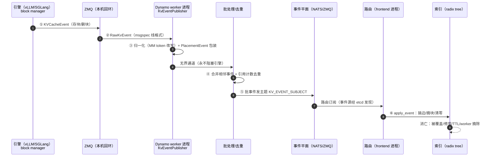
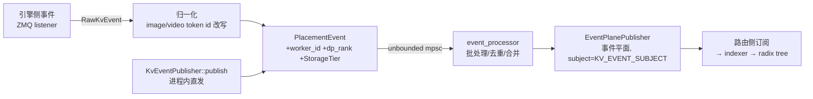

# 第 10 章 · KV 事件与发布订阅（源码深读版）

> **适合谁读**：所有读者（第三部分必读）。初学者先读 10.0 人话版建立直觉，
> 再进 10.2 起的源码；赶时间面试可以只读 10.0-10.2 + 面试指引。
> **前置**：ch07（事件平面）、ch09。
> **耗时**：55 分钟（人话版 8 分钟，源码 47 分钟）
> **源码锚点**：commit `61e9184`（v1.5.0）。本章引用的常量、字段、流程均核对过源码。

**学完能：**
- 用一句生活类比说清"KV 事件是什么、为什么必须是尽力而为"
- 拆解 `KvEventPublisher` 的五段内部管线，说出每段的存在理由
- 默写 KV 事件的线格式（`RawKvEvent`）主要字段，解释 LoRA/多模态/EAGLE/命名空间字段各自解决什么
- 区分 KV 事件与 worker 负载指标两条流（主题、结构、语义都不同）

---

## 10.0 人话版：先把 KV 事件想明白（零代码）

**第三部分类比总纲**（ch10–13 共用，先记住这五句话）：

把推理集群想成一家连锁餐厅——

- 每个 **worker 是一位厨师**（带着自己的灶台和冰箱）；
- **KV cache 是冰箱里的备菜**：算过一次的注意力键值留在显存里；
- **请求是一桌客人**：prefill 是"从零备菜"，很贵；如果哪位厨师冰箱里
  已经有这桌客人点的菜的前半部分（前缀），就能**从那里继续切**——
  命中越多省得越多；
- **多轮对话 = 同一桌客人接连点菜**：他们的历史订单（对话前缀）越来越
  长，上次招待过他们的厨师那里备菜全在——**把回头客送回记得他的厨师**，
  这就是 KV 路由的全部动机。

这个类比下，本章回答的问题很自然：**领班（路由）怎么知道每位厨师冰箱里
有什么？** 答案：厨师一边干活一边喊话——"这锅高汤备好了 4 块"
（BlockStored）、"冰箱满了，我把那半份西兰花扔了"（BlockRemoved）。
每一条喊话就是一个 KV 事件。

读源码前先想通三件事，后面所有设计都从它们推出来：

1. **为什么是增量事件，不是定时同步全量清单？** 冰箱内容变得勤，全量
   清单又大又浪费；"存了 X / 删了 Y"的增量天然轻。代价是领班可能漏听
   ——所以整套设计是**尽力而为**：漏听了顶多派错厨师，客人到了发现
   备菜不在，厨师重切一遍就是，**正确性无损，只是次优**。记住这句话：
   **索引允许错，结果不允许错**。这是整个第三部分的可靠性哲学。
2. **喊话太密会不会吵死人？** 会。所以攒批发送（128 块/批）+ 同批去重
   （后一条覆盖前一条的，前一条直接不发了）。
3. **厨师换了（引擎重启）怎么办？** 喊话者身份与厨师绑定：人换了，领班
   把他那一栏整体清零重来（Cleared），绝不沿用旧账——否则照旧账派客，
   客人到了才发现半成品根本不在。"引擎重启后命中率异常"排障先想这里。

> **面试 60 秒开场**（被问"KV 感知路由的感知从哪来"时）：
> "每个 worker 把 KV cache 的变化以事件发布——块存了/删了，带块哈希和
> 父块哈希。路由订阅这些事件维护全局前缀索引，请求来了用 token 哈希查
> 索引，就知道每个 worker 有多少可复用前缀。关键是这条流尽力而为：丢了
> 顶多路由次优、引擎重算兜底，正确性不受影响——所以敢用无界队列、敢
> 批处理。"完整追问链见面经 Q5，细节在 10.2–10.7。

## 10.1 一条 KV 事件的完整生命周期

把四个问题一次问清：**传输的是什么？从哪儿来？怎么传输？怎么维护？**
一条 BlockStored 事件的一生分六站，先给全景再逐站展开：



| 站 | 一句话 | 详解 |
|----|--------|------|
| ① 诞生 | 引擎的 block manager 在存/删 KV 块时产生事件——**Dynamo 不生产事件，只搬运和加工** | 10.2 |
| ② 出引擎 | 引擎进程内 ZMQ PUB → Dynamo worker SUB，**本机回环、每 dp_rank 一个端口**；载荷是 `RawKvEvent` 线格式 | 10.2、10.4 |
| ③ 加工 | 归一化（多模态 token 方案改写）→ 补空间坐标（worker_id/dp_rank/存储层） | 10.3 |
| ④ 压缩 | 无界通道 → 批处理（合并相邻同类事件）→ 引用计数去重 | 10.3 |
| ⑤ 广播 | 事件平面（NATS 或 ZMQ）主题 `KV_EVENT_SUBJECT`；**事件源注册进 etcd，路由按发现订阅** | 10.3 |
| ⑥ 记账与消亡 | 路由 `KvIndexer::apply_event` 维护 radix tree；记录的五条消亡途径见下 | 10.5 + ch11 |

**"怎么维护"的两层含义**要分开记：

- **传输维护**（发布器侧）：事件编号 `next_event_id` 单调递增可测缺口、
  批处理/去重控制流量、发布器与引擎生死耦合（细节 10.3/10.5）；
- **状态维护**（索引侧，ch11 主场）：Stored 沿父块哈希插边、Removed 摘块、
  Cleared 清零整个 (worker, dp_rank) 栏目。一条记录的**消亡有五途**：
  被 Remove/Cleared 事件覆盖；索引内存超限被近似 LRU 修剪；无事件模式
  TTL 过期（120s，ch13）；worker 注销时整栏摘除；被 `dump_tree_as_events`
  导出重放（转生，不是消亡——快照=事件序列，ch11）。

## 10.2 诞生：引擎侧怎么产生事件

事件的第一现场在推理引擎内部。以 vLLM 为例走一遍（SGLang 同构）：

**前提**：vLLM 必须开 `--enable-prefix-caching`——不开就没有块级记账，
`create_kv_events_config`（`components/src/dynamo/vllm/args.py:481`）直接返回
`None`，整条 KV 路由链路静默关闭。排障"为什么路由不感知 KV"，第一件事
查这个开关。

**产生**：开了之后，vLLM 的 block manager 在存块/淘汰块时产生
`KVCacheEvent`，由 vLLM 自己的 `kv_events_config`（`KVEventsConfig`，
ZMQ 发布器）发到进程内 ZMQ PUB socket。**每路数据并行一个端口**
（`ZmqEventPublisher.offset_endpoint_port`）——dp_rank 0/1/2 各占一个端口，
事件流互不混淆。SGLang 用同名的 `ZmqEventPublisher`
（`sglang.srt.disaggregation.kv_events`，接入点
`components/src/dynamo/sglang/publisher.py:15`）。

**Dynamo 侧接收**：worker 进程启动时 `setup_kv_event_publisher`
（`components/src/dynamo/vllm/main.py:443`）为自己管辖的每个 dp_rank 创建
一个 `KvEventPublisher`——这是个 PyO3 对象，本体在 Rust
（`lib/bindings/python/rust/llm/kv.rs:1115` →
`lib/llm/src/kv_router/publisher/mod.rs`）——以 SUB 模式连
`tcp://127.0.0.1:<port>`。**注意方向：引擎是 PUB，Dynamo 是 SUB**，走本机
回环（引擎与 Dynamo worker 同 pod）。创建时还带上
`kv_event_block_size`（路由切块大小要对齐引擎，来自 MDC）和
`image_token_id`/`video_token_id`（多模态归一化参数，见 10.3 ①）。

三个变体（同一套 publisher 接不同的源）：

- **KVBM/consolidator 模式**：不订引擎直发，改订 consolidator 的 5558 端口
  （`main.py:490-492`）——KVBM 的下放/驱逐事件从这条通路来；
- **进程内直发**：Dynamo 自己管理的块（如 Rust 侧 KVBM 下放）调
  `KvEventPublisher.publish()` 直接投 PlacementEvent，不绕 ZMQ；
- **state agent v2**：`state_agent_settings` 模式下换用
  `setup_kv_state_attachment_owner`——KV 状态所有权与请求服务分离
  （`state_agent.rs`，ch16 展开）。

PUB/SUB 的方向也解释了 10.5 要讲的生死耦合：SUB 端无法感知对端 PUB 换没
换进程，只能靠 publisher_id 绑定 + `Cleared` 语义兜底。

## 10.3 Dynamo 怎么搬运：任务、时机与处理点

`lib/llm/src/kv_router/publisher/mod.rs` 的 `KvEventPublisher`（195 行起）
内部是一条五段管线——事件离开引擎 socket 后就在这条管线里走完 ③④⑤ 站：



**什么时候搬运**（三问里最容易被含糊带过的）：

- **任务何时起跑**：worker 进程启动时 `setup_kv_event_publisher` 构造
  `KvEventPublisher`（`mod.rs:213` 起的 `new*` 系列），构造函数里立刻
  spawn **两个异步任务**——ZMQ 监听（`mod.rs:144`，外面套一层
  `supervise_zmq_listener`（`:161`）挂了自动重启）和事件处理器
  （`mod.rs:452`）——跑在 runtime 的 **secondary 线程池**（`:366`），
  不占请求热路径的线程。
- **事件何时流动**：没有定时器、没有轮询。监听任务挂在
  `socket.next()` 上纯被动等——**引擎什么时候存/删块，事件什么时候来**。
  引擎侧的典型触发点：prefill 完成块落缓存（Stored）、缓存淘汰/释放
  （Removed）。
- **搬运什么时候结束**：worker 优雅退出（Drop → shutdown：取消令牌、
  注销 etcd 事件源）或监听/通道断开（循环带 `exit_reason` 退出）。

**从哪儿搬、怎么搬——接收任务逐行走**（`zmq_listener.rs:48`
`start_zmq_listener`）：

1. `connect_sub_socket(endpoint, topic)`：SUB socket **connect** 到引擎的
   PUB 地址（本机回环），订阅指定 topic；
2. `tokio::select!` 双路复用（`biased`：取消令牌优先检查），主路是
   `socket.next()` 收**三帧 ZMQ 报文**：
   `[topic, sequence, payload]`——`sequence` 是 8 字节大端 u64（**引擎侧**
   批序号，用于对账），`payload` 是 **MessagePack** 编码的
   `KvEventBatch`（`rmp_serde::from_slice`，`zmq_wire/mod.rs:43`——这个
   线格式镜像 vLLM Python 端 msgspec 结构，所以引擎不用为 Dynamo 改代码）；
   一个 batch 里有多条 `RawKvEvent` 加 `data_parallel_rank`；
3. 每条原始事件过 `ZmqEventNormalizer`：多模态 token 归一化 + **过滤**
   （Ignored 事件、非本地 locality、未知 medium 等都有明确 reason 记进
   metrics）；被过滤的事件**不消耗** publisher 的事件号；
4. 通过的 `fetch_add` 领一个 publisher 本地 `event_id`（跨 dp_rank 单调）；
5. 打包成 `Vec<PlacementEvent>` 经**无界通道** `tx.send()` 交给处理任务
   ——无界意味着接收任务永不被下游反压。

**在哪儿处理成最终形态——处理任务逐行走**（`event_processor.rs:20`
`run_event_processor_loop`）：

1. `rx.recv()` 主循环，三路 select（取消 / 批到达 / 超时冲刷）；
2. **缺口检测**：原始 event_id 跳号 → `engines_dropped_events` 指标
   （注意语义：这只统计"到达处理器之前"就丢了的事件，批处理和去重
   不影响它——README 明确钉死过这个口径）；
3. Stored/Removed 进 `batching_state.push` 合并，五个冲刷条件：事件类型
   变、dp_rank 变、存储层变、parent 链断、超时或 128 块上限；
4. **Cleared 特例**：先冲刷挂起批 → 清该 rank 的去重引用计数 → 让本地
   索引（若启用）复位；**复位失败会"fencing"整个发布器**——取消自己的
   令牌主动下线（`event_processor.rs:120-134` 注释：本地快照与对外通告的
   游标一旦分叉，唯一安全的做法是整个事件源下线）；
5. `sinks.rs::emit`：同一条 `RouterEvent` **先应用本地索引、再对外发布**
   ——两个副作用看到同一事件，不分先后竞态；
6. `EventPlanePublisher.publish_events` → NATS 主题 `KV_EVENT_SUBJECT`
   （连接在构造时建好，ch07）。

处理点速查（"哪个文件管哪段"）：

| 文件（`lib/llm/src/kv_router/publisher/`） | 职责 | 触发 |
|------|------|------|
| `zmq_listener.rs` | SUB 连引擎、三帧解码（MessagePack）、归一化/过滤、编号、入通道 | socket 事件驱动 |
| `event_processor.rs` | 缺口检测、批处理、去重、Cleared fencing、对外发布 | 通道消息/超时 |
| `batching.rs` / `dedup.rs` | 合并算法（五冲刷条件）/ 引用计数去重 | 被 processor 调用 |
| `sinks.rs` | 本地索引应用 + 事件平面发布（同一事件双写） | 被 flush 调用 |
| `mod.rs` | 组装：spawn 两任务、etcd 事件源注册、supervise 重启 | worker 启动/退出 |

三个阶段拼成一张时序图（启动 → 稳态搬运 → 故障/退出）：

```mermaid
sequenceDiagram
    autonumber
    participant W as worker 启动<br/>setup_kv_event_publisher
    participant L as 接收任务<br/>zmq_listener.rs
    participant E as 引擎 vLLM/SGLang<br/>ZmqEventPublisher（PUB）
    participant P as 处理任务<br/>event_processor.rs
    participant LI as 本地索引<br/>LocalKvIndexer（可选）
    participant N as 事件平面<br/>NATS · KV_EVENT_SUBJECT
    participant T as etcd
    participant R as 路由 frontend<br/>KvIndexer

    rect rgb(235,245,255)
    Note over W,R: 启动阶段——什么时候起跑
    W->>W: KvEventPublisher::new（mod.rs:213）
    W->>L: spawn 监听任务（mod.rs:144，<br/>supervise 挂了自动重启）
    W->>P: spawn 处理任务（mod.rs:452，secondary 线程池）
    L->>E: SUB connect tcp://127.0.0.1:port<br/>（每 dp_rank 一个端口）
    W->>T: 注册 DiscoverySpec::EventSource<br/>（publisher_id / kv_state_endpoint）
    T->>R: watch 发现新事件源
    R->>N: 订阅 KV_EVENT_SUBJECT
    end

    rect rgb(235,255,235)
    Note over E,R: 稳态搬运——事件驱动，无定时器
    E-->>L: 三帧报文 [topic, seq, MessagePack(KvEventBatch)]
    L->>L: 解码 → 归一化（MM token）→ 过滤<br/>通过者 fetch_add 领本地 event_id
    L->>P: 无界通道 tx.send（Vec&lt;PlacementEvent&gt;，永不反压）
    P->>P: 缺口检测 → 批处理（五冲刷条件，≤128 块）<br/>→ 引用计数去重
    P->>LI: sinks.emit：先应用本地索引
    P->>N: 再发布 RouterEvent 批（同一事件双写）
    N-->>R: 投递事件批
    R->>R: apply_event：插边/摘块/清零<br/>（ch11 radix tree）
    end

    rect rgb(255,245,235)
    Note over E,R: 故障与退出路径
    E--xL: 引擎重启——SUB 无感知（旧账已失真）
    Note over L,R: 规范路径：publisher_id 生死耦合<br/>+ 按序 Cleared 清零该 rank
    P->>LI: Cleared 复位本地索引失败？
    P--xP: 是 → fencing：取消令牌，整个事件源下线
    W->>T: worker 退出：Drop → shutdown<br/>冲刷挂起批 → 注销事件源
    T->>R: 事件源消失 → 路由摘除该 worker 记录
    end
```

五段管线的设计动机（为什么每段存在）：

**① 事件源（ZMQ，当前唯一支持的外部源）**。`KvEventSourceConfig::Zmq`
（`mod.rs:69`）带四个参数：endpoint、topic、`image_token_id`、`video_token_id`。
后两个是**多模态归一化**用的：vLLM 的 `BlockStored` 事件里的块哈希可能基于
引擎原生的图像/视频占位符 token 方案，监听器会把它们改写成 Dynamo 的规范
`pad_value` 方案，否则同一张图在引擎侧和路由侧会哈希出两个不同身份。
文本-only 部署传 `None`，归一化是空操作。

**② 事件包装（PlacementEvent）**。裸事件只说"哪些块存/删了"；
`PlacementEvent` 补上空间坐标：

```rust
PlacementEvent::new(
    Placement::local_worker(self.worker_id, event.dp_rank, storage_tier),  // Gpu / HostPinned / Disk
    event,                                                                // KvCacheEvent
)
```

`publish_with_storage_tier()`（`mod.rs:514`）说明：KVBM 下放（ch16）产生的
"块现在在 CPU"事件和引擎产生的"块在显存"事件走同一条管线，只是 tier 不同
——索引天然分层（ch11 的 `tier_overlap_blocks`）从这里就开始了。

**③ 通道与批处理**。`mpsc::unbounded_channel::<Vec<PlacementEvent>>()`——
发送永不阻塞 worker。下游 `event_processor` 做合并：
`DEFAULT_MAX_BATCH_BLOCKS = 128`（单批块数上限）、批超时默认 **None**、
上限强制 15 秒（`MAX_BATCHING_TIMEOUT_MS`，超了会告警并截断）。`dedup.rs`
再滤掉被同批后续事件覆盖的条目。

**④ 事件平面发布**。`EventPlanePublisher` 把批事件发到主题
`KV_EVENT_SUBJECT`（NATS 或 ZMQ，ch07 的可插拔事件平面）。

**⑤ 一个容易忽略的细节：事件源本身也走服务发现。** 发布器启动时向 etcd
注册 `DiscoverySpec::EventSource`，元数据里带 `kv_state_endpoint`、
`WorkerWithDpRank`、`publisher_id`、`recovery_target`（`mod.rs:416-440`）。
路由侧不是"盲目订阅一个话题"，而是**从 etcd 发现当前活着的事件源**再订阅
——worker 生死与事件源存亡保持一致（ch08 的 lease 语义延伸到了事件面）。

## 10.4 线格式：`RawKvEvent`

`lib/kv-router/src/zmq_wire/types.rs:88` 定义跨进程序列化格式（msgspec 风格，
`#[serde(tag = "type")]`）：

```rust
pub enum RawKvEvent {
    BlockStored {
        block_hashes: Vec<BlockHashValue>,       // 块哈希序列（signed/unsigned 归一到 u64）
        parent_block_hash: Option<BlockHashValue>, // 父块哈希（radix 树的边）
        token_ids: Vec<u32>,                     // 原始 token（用于重建/校验）
        block_size: usize,
        medium: Option<String>,                  // 存储介质
        lora_name: Option<String>,               // LoRA 适配器感知的块哈希
        cache_salt: Option<String>,              // 实际语义是 cache_namespace（见注释）
        block_mm_infos: Option<Vec<Option<BlockExtraInfo>>>, // 多模态对象在块内的偏移
        is_eagle: Option<bool>,                  // 投机解码（EAGLE）目标 KV
        group_idx: Option<u32>,                  // EAGLE 分组
        kv_cache_spec_kind: Option<KvCacheSpecKind>,        // 如滑动窗口注意力
        kv_cache_spec_sliding_window: Option<u32>,
        locality: Option<Locality>,
        ownership: Option<String>,               // framework / kvcr（KV cache retention）
    },
    BlockRemoved { block_hashes, medium, group_idx, ... },
    AllBlocksCleared { ownership },
    Ignored,
}
```

值得讲的三组字段：

- **`parent_block_hash` + `block_hashes`**：事件携带的是"从父块延伸出的块链"，
  正好是 radix 树一次插入需要的形状（ch11）。
- **`lora_name` / `cache_salt`**：块身份不是纯 token 哈希——换了 LoRA 适配器
  或换了缓存命名空间，同样 token 算出的哈希**必须不同**（KV 内容不同）。这
  是多租户隔离的第一道闸（第二道在 ch11 的 keyed tracking）。
- **`is_eagle` / `group_idx` / `kv_cache_spec_*`**：投机解码的 draft/target
  KV、滑动窗口注意力各有独立块空间，线格式原生支持。

进程内的规范形态则是 `protocols.rs:1229` 的 `KvCacheEventData`：

```rust
pub enum KvCacheEventData {
    Stored(KvCacheStoreData),   // { parent_hash, start_position: Option<u32>, blocks }
    Removed(KvCacheRemoveData),
    Cleared,                    // 清空该 (worker_id, dp_rank) 的全部 KV 记账
}
```

`start_position` 用于**位置敏感重放**（positional replay，配合 ch11 的
`positional.rs`——同一个块出现在序列不同位置，可复用性不同）。

## 10.5 发布器生命周期与故障语义

- **单调事件序**：`next_event_id: Arc<AtomicU64>`（`mod.rs:209`）给每个事件
  编号；ZMQ 监听器与进程内直发共享计数器，消费侧可以检测缺口。
- **发布器生死耦合**（文档注释明说，`mod.rs:189-194`）：引擎侧发布器与
  Dynamo 侧 `publisher_id` 绑定，**不支持引擎单独重启而发布器存活**；将来
  要支持，必须先发一条按 rank 有序的 `Cleared` 或换新 publisher_id——否则
  新引擎实例的块身份与旧索引记账对不上。排障见到"引擎重启后命中率异常"，
  先想到这里。
- **恢复通道**：如果启用了 worker 本地索引（`LocalKvIndexer`），发布器还会
  起一个 `start_worker_kv_query_endpoint`（`mod.rs:384`）——路由可以**主动
  拉取**该 worker 的索引快照做恢复；起失败则广播"live-only KV source"（只
  有实时流、无法回溯），路由侧降级而非崩溃。
- **优雅退出**：`Drop for KvEventPublisher` 触发 `shutdown()`：取消令牌、
  中止监听、从 etcd 注销事件源。

## 10.6 另一条流：worker 负载指标

`publisher/worker_metrics.rs` 的 `WorkerMetricsPublisher` 与 KV 事件**平行且
独立**，别混为一谈：

| | KV 事件 | 负载指标 |
|---|---------|----------|
| 主题 | `KV_EVENT_SUBJECT` | `KV_METRICS_SUBJECT` |
| 结构 | `RawKvEvent`/`PlacementEvent`（块级） | `ActiveLoad { worker_id, dp_rank, active_decode_blocks, active_prefill_tokens, kv_used_blocks }` |
| 语义 | "我缓存/释放了哪些块"（状态增量） | "我现在多忙"（瞬时快照） |
| 节流 | 批处理 + 去重（128 块/批） | watch channel 去重 + **1ms 防抖**（`PUBLISH_DEBOUNCE`） |
| 消费者 | 索引（ch11） | 打分器（ch12 的负载项） |

注意 `ActiveLoad.active_prefill_tokens` 在 worker 侧发布时是 `None`——
prefill 侧的在途 token 数由**路由自己在 `add_request` 时记账**
（`router_track_prefill_tokens`，默认开）：因为只有路由知道请求何时被接受，
worker 永远滞后。这个"谁来记账"的选择是 ch13 序列跟踪的入口问题。

## 10.7 尽力而为语义（深版重述）

ch01 建立过"索引允许错、结果不允许错"的直觉，现在可以精确到机制：

| 丢失/乱序 | 检测/自愈机制 |
|-----------|---------------|
| 事件缺口 | `next_event_id` 单调性可检测；重放用 `start_position` |
| 引擎重启 | publisher_id 生死耦合 + `Cleared` 语义（10.5） |
| 索引"多记" | 路由到目标后未命中 → 引擎重算，正确性无损（ch11 深版展开） |
| 索引"少记" | 只是次优；predict-on-route 侧索引（ch11）用路由决策本身回补 |

## 面试指引：本章能答什么

完整问答与追问链见[面经-Dynamo](../面经-Dynamo.md) **Q5**（KV 感知的
信息流）与 **Q17**（worker 挂了系统里发生什么——事件源注销是其中一环）。

章内补充问法（面经未展开、从本章源码细节长出来，答上就是加分项）：

1. **"KV 事件是谁产生的？Dynamo 和引擎怎么分工？"** → 要点：事件第一
   产生者是引擎 block manager（vLLM/SGLang 的 `ZmqEventPublisher`，每
   dp_rank 一端口），Dynamo worker 以 SUB 接回环、只做归一化/包装/批处理/
   转发——Dynamo 不生产事件，只搬运和加工；前提是引擎开 prefix caching。
   跨进程序列化是 MessagePack（`rmp_serde`，三帧报文含引擎侧批序号），
   与 vLLM 的 msgspec 结构镜像，引擎无需为 Dynamo 改代码。
2. **"KV 事件这么密，会不会把路由打爆？"** → 要点：无界通道保证 worker
   永不阻塞 → 批处理（128 块/批，15s 强制上限）→ 同批去重；事件源经
   etcd 发现注册，路由只订阅活着的事件源。
3. **"事件乱序/丢失怎么保证正确性？"** → 要点：`next_event_id` 单调序可
   检测缺口；丢了不补——路由到目标未命中则引擎重算，多记是"白跑一趟"
   的性能问题不是正确性问题。
4. **"为什么负载指标不合并进 KV 事件流？"** → 要点：语义不同（状态增量
   vs 瞬时快照）、节流策略不同（批处理 vs 1ms 防抖）、消费者不同（索引
   vs 打分器）——两条流各有自己的主题和生命周期，合并反而互相拖累。

## 小结

- 一句话：引擎产生、Dynamo 加工转发、路由记账——worker 喊话（存了/
  删了哪些块），路由听着记；漏听不误事，引擎重算兜底。
- 完整链路六站：引擎 block manager → ZMQ 回环（PUB/SUB，每 dp_rank
  一端口）→ 归一化/Placement 包装 → 无界通道 → 批处理/去重 → 事件
  平面（NATS/ZMQ，事件源经 etcd 发现）→ 索引 apply_event。
- 线格式字段即设计文档：parent 链、LoRA/命名空间盐、EAGLE 分组、位置重放。
- 两条流分清楚：KV 事件（状态增量，进索引）vs 负载指标（快照，进打分）。

## 自检（9 题，自答）

1. KV 事件的第一产生者是谁？Dynamo 在链路里扮演什么角色？开启这条
   链路的前提开关是什么？
2. 引擎和 Dynamo worker 之间是什么传输、什么方向（谁 PUB 谁 SUB）？
   为什么能走本机回环？多路数据并行的事件流怎么区分？
3. Dynamo 搬运事件的两个异步任务分别叫什么、各自在哪一步起跑？
   事件靠什么触发流动——定时器还是引擎行为？
4. ZMQ 报文是几帧结构？payload 用什么序列化格式？引擎侧批序号和
   publisher 本地 event_id 是一回事吗？
5. 引擎进程单独重启（Dynamo 发布器对象还在），为什么索引会出问题？
   规范的修复路径是什么？Cleared 复位本地索引失败时发布器怎么办？
6. KVBM 把一块 KV 从显存下放到 CPU，事件流上发生了什么？（提示：
   `publish_with_storage_tier`）
7. 多模态部署里 `image_token_id` 不传会发生什么？症状会表现为什么？
8. `ActiveLoad.active_prefill_tokens` 为什么不由 worker 上报？
9. 批处理上限 128 块 + 15 秒强制截断，各自防的是什么病？

## 下一步（跳转推荐）

- → [ch11 前缀索引：Radix Tree](ch11-prefix-index.md)（这些事件如何变成树）
- → [ch12 路由决策](ch12-routing-decision.md)（overlap 数字如何进入打分）
