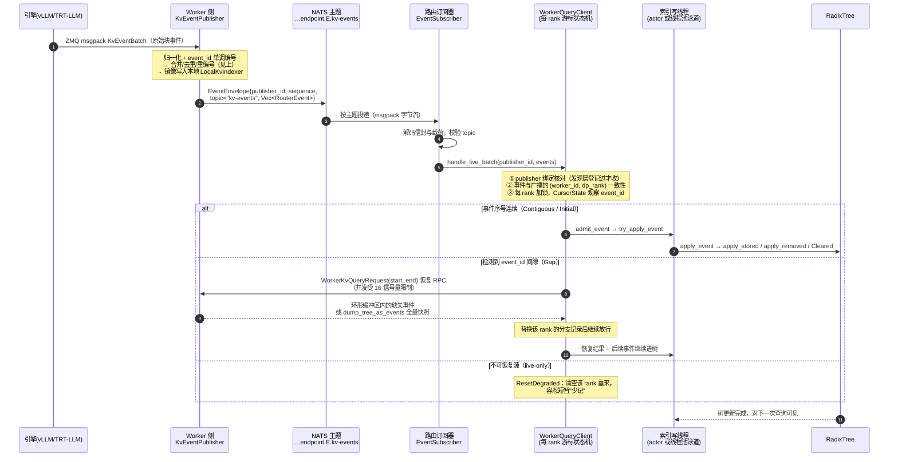
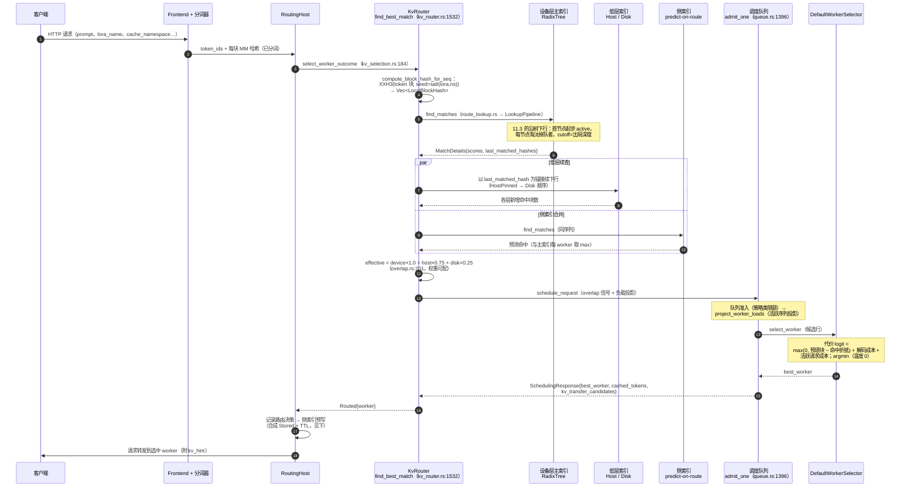
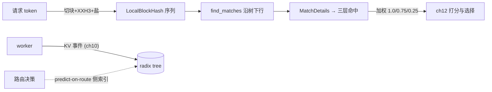

# 第 11 章 · 前缀索引：Radix Tree 与变体（源码深读版）

> **适合谁读**：所有读者（第三部分核心章）。初学者先读 11.0 人话版，
> 源码部分（11.1 起）可第二遍再啃。
> **前置**：ch10。
> **耗时**：75 分钟（人话版 8 分钟，源码 67 分钟）
> **源码锚点**：commit `61e9184`（v1.5.0）。

**学完能：**
- 用餐厅类比说清"为什么索引长成 radix tree"以及"错账为什么不致命"
- 画出 `NodeState` 的节点结构，手推一次"插入分裂"和"沿树查询"
- 说清一条 KV 事件从 NATS 主题到 `RadixTree::apply_event` 的**全部中转站**
  （订阅、解码、游标状态机、恢复、actor 泳道）
- 说清一次查询从 HTTP 请求到选中 worker 的**逐步**路径
- 解释块哈希身份系统（XXH3、LoRA 盐、命名空间盐、keyed tracking）与
  `KvIndexer` 的 actor 化结构、四种部署形态

---

## 11.0 人话版：领班的账本（零代码）

接着 ch10 的餐厅：厨师们一直在喊"我备好了什么菜"，领班（路由）得把
这些喊话记成一个**账本**，客人一来就能翻账本回答："这道菜的前半部分，
哪几位厨师那儿有？各有多少？"——这本账就是**前缀索引**。

三个先想通再读源码的直觉：

1. **为什么账本天然是棵树？** 因为备菜是"链式"的：第 100 刀只能切在
   前 99 刀之后。两桌客人点的菜如果前 50 刀相同、之后分岔，那这 50 刀
   是**共享的**——按前缀组织成一棵树（radix tree），公共部分只记一次。
   查"新客人这道菜各位厨师备到第几刀"，就是沿树下行看谁在哪一步掉队。
   这就是 `find_matches` 干的事：返回 `{厨师 → 备到第几块}`。
2. **账本是干嘛的、不是干嘛的？** 它只服务于**派单建议**，不保证正确
   ——账本多记了（厨师其实已经把备菜扔了），客人到了重切一遍，无害；
   账本少记了（事件还没到），只是没派到最优厨师，次优。**所以索引可以
   用近似 LRU 修剪、可以并发修复、可以布谷过滤器粗筛**——一切为了快，
   精确性让位。这句话是理解本章所有"变体"的钥匙。
3. **怎么记账才不会被冒充？** 账本按"每段菜的指纹"（块哈希）记账，而
   指纹里掺了盐：换了 LoRA 适配器、换了租户命名空间，同样 token 的指纹
   就不同（KV 内容确实不同）。更进一步，指纹算法可以带密钥（keyed
   tracking）——没有密钥的外人算不出合法指纹，也就**无法靠构造特定
   请求探测别的租户在缓存什么**（路由行为侧信道）。

> **面试 60 秒开场**（被问"前缀索引怎么实现"时）：
> "路由侧维护一棵压缩 radix tree：节点存一段块哈希序列（边），
> 每个节点记录'哪些 worker 备齐了整条边、哪些只备到边内第 k 块'。
> worker 的 KV 事件经 NATS 主题投递到路由，按每 rank 单调 event_id
> 校验连续性（有间隙就向 worker 发恢复 RPC），最终在专属线程上
> `apply_event` 更新树。查询时拿请求的块哈希序列沿树下行，每个节点
> 淘汰一批掉队 worker，返回每人的命中深度，再按存储层级加权。
> 设计哲学是索引尽力而为：多记无正确性问题、少记只是次优。"
> 完整追问链见面经 Q6/Q7，细节在 11.1 起。

## 11.1 接口契约：`SyncIndexer`

`lib/kv-router/src/indexer/traits.rs` 定义索引的核心抽象：

```rust
pub trait SyncIndexer: Send + Sync + 'static {
    fn find_matches(&self, sequence: &[LocalBlockHash], early_exit: bool)
        -> OverlapScores;                                    // traits.rs:220
    fn find_matches_from_anchor(...);   // 分片索引用，见 11.7
    // ...
}
pub trait AnchorCapableSyncIndexer: SyncIndexer {}   // 能力标记 trait
```

三个设计点：

- **输入是块哈希序列，不是 token 序列**。调用方拿着 token 先切块、算哈希
  （11.2），索引只见哈希——索引完全不关心词表和分词，天然与引擎解耦。
  另有便捷入口 `find_matches_for_request`（traits.rs:93）在索引内部代做
  哈希，热路径不用。
- **`early_exit`**：调用方可以宣告"我只要知道命中是否足够好，不需要精确
  值"，索引在只剩一个活跃 worker 时提前剪枝。诚实备注：当前生产调用点
  **全部传 `false`**（`kv_indexer.rs:706`、`lookup.rs` 各处）——这是个
  接口里预留、暂时休眠的优化位。
- **返回值的分层不在这一层**。`OverlapScores`（`protocols.rs:1647`）只是
  **单层**命中：`{ scores: FxHashMap<WorkerWithDpRank, u32>, frequencies }`。
  分层（显存/CPU/磁盘）是上面一层的事：`LookupPipeline` 先查设备层主树，
  再用结果作锚查低层，合成 `TieredMatchDetails { device, lower_tier }`
  （`lower_tier_indexers.rs:145`）——11.5 会走完整链路。另有
  `SharedKvCache` 与 `TieredMatchProvider`（traits.rs:33）两个 trait 分别
  抽象共享缓存查询与分层匹配供给。

## 11.2 块的身份系统

**算法是 XXH3-64，不是 Blake3**（Blake3 只用于 cache-owner 哈希，
`protocols.rs:557`）。核心常量：`XXH3_SEED = CHAIN_XXH3_SEED = 1337`
（`protocols.rs:26`、`lib/tokens/src/lib.rs:61`）。

一个块有两重身份，**这一区分是理解树结构的钥匙**：

| 身份 | 算法 | 语义 |
|------|------|------|
| `LocalBlockHash` | `XXH3(块内 token 的 LE u32 字节 [+ 追加的 MM 哈希], seed=salt_hash)` | 块**内容**指纹，与位置无关——同 token 同盐即同哈希，用于**分叉**（children 键） |
| `ExternalSequenceBlockHash` | `seq[0]=local[0]; seq[i]=XXH3([seq[i-1], local[i]] 的 LE 字节, seed=1337)` | 从序列头到本块的**累积**指纹，位置敏感——用于**锚定**（parent 链、低层续查） |

路由热路径的实现是 `compute_block_hash_for_seq`（`protocols.rs:106`，
逐块切块、MM 块追加多模态对象哈希后一起哈希）；`lib/kv-hashing/` 是与之
字节兼容的"通用契约"crate（供 worker/consolidator 复用），链式哈希在
`protocols.rs:203` `compute_next_seq_hash`。块大小 = `block_size`
（Eagle 用 `block_size+1` 的窗口，`protocols.rs:114`）。

**盐**决定隔离强度（`kv-hashing/src/salt.rs:49`）：

| 盐 | 来源 | 效果 |
|----|------|------|
| LoRA 适配器名 | `salt_hash += XXH3(lora名, seed=0)` | 同 token + 不同 LoRA = 不同块（KV 数值不同） |
| 缓存命名空间 | `salt_hash += XXH3(命名空间, seed=1)` | 租户/业务级隔离 |
| **keyed tracking** | `router_tracking_hash=keyed-xxh3-v1` + `DYN_ROUTER_TRACKING_KEY_FILE`/`_KEY_ID`（`tracking_hash.rs`，域分隔串 `dynamo.router.tracking-hash/keyed-xxh3-v1`） | 带密钥派生作用域：没有密钥的一方**无法**为任意 token 序列构造合法块哈希 |

盐公式一句话：`salt_hash = 1337 + xxh3(lora) + xxh3(namespace)`（空串
归一化为无）。MM 数据**不进盐**——同一张图在相同全局位置时，图之前的
前缀块仍能共享，图本身按块哈希区分。

keyed tracking 是个容易被忽视的安全细节：块哈希本是确定性的——任何人
都能算出"系统提示词 X 的块哈希"，然后通过观察路由行为做**前缀探测侧信道**
（"这个租户是不是在用这段提示词？"）。带密钥的跟踪哈希把"能构造哈希"的
能力限制在持有密钥的路由域内。

链接哈希（含 parent）还有一个好处：**树上的路径就是身份的一部分**——两个
不同前缀分叉后的相同块内容得到不同序列哈希，天然防"同内容不同位置误合并"。

## 11.3 `RadixTree` 本体：结构、插入、查询

`lib/kv-router/src/indexer/radix_tree.rs`。先看朴素方案为什么不行，再看
树怎么长出来。

### 为什么是（压缩）radix tree

- **方案 A：全局哈希表** `HashMap<某前缀指纹, Set<Worker>>`。按什么粒度
  记？按序列全长记，查不到"部分命中"；按每个位置记，长度 L 的请求要存
  L 条记录、公共前缀在每个位置重复——内存和写入都爆炸。
- **方案 B：每个 worker 一条链**。公共系统提示词（几千块）在每个 worker
  的链里各存一遍，内存 ×W；查询要遍历所有 worker 的链。
- **radix tree（压缩）**：公共前缀在树上**只存一次**；一条边（edge）
  压缩存放一整段连续块，不为单块建节点；查询从根沿孩子哈希下行，
  每步一次 `FxHashMap` 查找，走到分岔/尽头为止；插入 O(块数)。

### 节点解剖（`compressed_radix.rs:64-76`）

```rust
pub(crate) struct NodeState {
    /// 压缩边：一段连续块，每块存 (LocalBlockHash, ExternalSequenceBlockHash)
    pub(crate) edge: Vec<(LocalBlockHash, ExternalSequenceBlockHash)>,
    /// 反查表：序列哈希 → 在 edge 中的下标
    pub(crate) edge_index: FxHashMap<ExternalSequenceBlockHash, usize>,
    /// 部分覆盖：worker_cutoffs[w] = k 表示 w 备齐了 edge[0..k]（0 < k < edge.len()）
    pub(crate) worker_cutoffs: FxHashMap<WorkerWithDpRank, usize>,
    /// 完整覆盖：备齐了整条 edge 的 worker
    pub(crate) full_edge_workers: FxHashSet<WorkerWithDpRank>,
}
// RadixBlock { state, children: FxHashMap<LocalBlockHash, _>, internal }  radix_tree.rs:18
// RadixTree   { root, lookup: FxHashMap<Worker, FxHashMap<SeqHash, 节点>> } :49
```

两个结构各司其职：

- **树上**：`children` 按 `LocalBlockHash` 分叉（同内容同块）；每个节点用
  `worker_cutoffs` + `full_edge_workers` 记录"谁备到哪"。**掉队记账不下移**
  ——一个 worker 只会在它掉队的那一个节点上有 cutoff 记录，更深处它不出现。
- **树外**：`lookup` 是每 worker 一张 `序列哈希 → 节点` 侧表。插入时拿事件
  的 `parent_hash`（序列哈希）O(1) 直达父节点，不用从根重走——这是插入
  事件（往往只带增量块）能做到 O(新块数) 的关键。

### 插入：`apply_stored` 逐步走（radix_tree.rs:252）

一个 `Stored` 事件 = `{parent_hash: Option<SeqHash>, blocks: Vec<块>}`：

1. **定位父节点**：`parent_hash=None` → 从根出发；否则查该 worker 的
   `lookup[parent_hash]`，并验证该 worker 确实覆盖到那个位置
   （`covers_pos`），否则报 `ParentBlockNotFound`（ch10 的尽力而为：
   事件有损时宁可拒收，靠恢复机制补，见 11.4）。
2. **快路径**（`try_reuse_parent_edge`，:411）：新块恰好是父节点边的
   延续 → 叶子直接 `append_blocks_to_leaf`；新块全被现有边覆盖 → 只是
   把该 worker 的 `cutoff` 提到相应位置（`cover_prefix_for_worker`）。
   常见场景（decode 逐块续写、重复请求）大多走这两条，不碰树形。
3. **慢路径**：沿 `children[local_hash]` 下行，逐节点比对新块序列与
   现有 `edge` 的公共前缀长度 `match_len`：
   - 新块走完了（`match_len == remaining.len()`）但边没走完 →
     `cover_prefix_for_worker(w, match_len)`：在**本节点**记一个
     partial cutoff，完事；
   - 边走完了（`match_len == edge_len`）→ `promote_to_full(w)`（w 备齐
     本节点整条边），剩余块继续往孩子走；
   - **在边中间分岔**（`match_len < edge_len` 且新块没走完）→
     `split_node(node, match_len)`（:452）：把边劈成前缀节点 + 后缀
     子节点，原有 cutoff ≥ 劈点的 worker 在前缀节点升为 full、后缀
     节点保留 `cutoff − 劈点`，两节点都重挂 `lookup`；然后把新块的
     尾段做成新叶挂到劈点下。
4. **更新侧表**：每个新块的序列哈希都指向所在节点（`update_lookup_for_blocks`）。

`Removed` 按 worker 收缩 cutoff/full 集合；`Cleared` 直接摘掉该 worker
在该 rank 下的全部记录（`remove_worker_dp_rank`，节点可能留给别人）。

### 工作示例：三工入树（建议拿笔推一遍）

块内容哈希记作 `B1..B5`，序列哈希记作 `s1..s5`。事件顺序：

1. **A 存 `[B1,B2,B3]`**（parent=None）→ 根下新叶 `N(edge=[B1,B2,B3],
   full={A})`。
2. **B 存 `[B1,B2,B4,B5]`**（parent=None）→ 与 `N` 公共前缀 2 < 3，且 B
   还有剩余块 → **分裂**：`N` 劈成 `N1(edge=[B1,B2], full={A})` +
   `N2(edge=[B3], full={A})`；B 在 `N1` 升 full，尾部 `[B4,B5]` 新叶
   `N3(full={B})` 挂 `N1` 下。
3. **C 存 `[B1,B2]`**（parent=None）→ `N1` 整边匹配 → `N1.full={A,B,C}`。
4. **C 存 `[B4]`**（parent=s2，decode 续写场景）→ `lookup[C][s2]` 直达
   `N1`，`covers_pos(C, 1)` 成立 → 走到孩子 `N3`，新块走完而边没走完 →
   `cover_prefix_for_worker(C, 1)`：`N3.cutoffs={C:1}`。

```text
root (edge 为空)
└─ 键=B1 → N1  edge=[(B1,s1),(B2,s2)]       full={A,B,C}  cutoffs={}
    ├─ 键=B3 → N2  edge=[(B3,s3)]           full={A}      cutoffs={}
    └─ 键=B4 → N3  edge=[(B4,s4),(B5,s5)]   full={B}      cutoffs={C:1}
```

### 查询：`find_match_details_with_options` 逐步走（radix_tree.rs:97）

输入：请求的块哈希序列 `[h0, h1, ...]`（**只有 local 哈希**）。状态：
`active`（还活着的 worker 集合）、`matched_depth`（已匹配块数）、
`seq_pos`（查询游标）。

1. **进门**：`root.children[&sequence[0]]`——首块决定入口，没有即 0 命中。
2. **对每个节点**：算查询剩余部分与 `edge` 的公共前缀长 `edge_match_len`
   （为 0 立即停）；**首节点特殊**：`active = full_edge_workers`（备齐首
   边的人起步），同时对每个 `cutoffs` 记 `score = min(cutoff,
   edge_match_len)`——首节点就掉队的直接出分。
3. **后续节点淘汰赛**：`active.retain`——
   在 `full_edge_workers` → 留下继续；有 `cutoffs` →
   `score = matched_depth + min(cutoff, edge_match_len)`，记分出局；
   都不在 → `score = matched_depth`，出局。**每过一个节点，树就替你
   剪掉一批候选 worker**——这就是 radix tree 的查询红利。
4. 同时记录每个出局者的 `last_matched_hash`（出局位置上的**序列**哈希，
   供低层索引接着查，11.5）。
5. `matched_depth += edge_match_len`；停止条件：`active` 空 / 查询在边
   中间分岔（`edge_match_len < edge.len()`）/ 序列匹配完 /
   `early_exit && active.len()==1`。否则 `seq_pos += edge_match_len`，
   下行 `children[&sequence[seq_pos]]`。
6. **收尾**：还活着的 worker 一律记 `score = matched_depth`（它们备齐了
   查询能匹配到的全部）。

复杂度：O(匹配深度 D) 次孩子查找，每次 O(1) 哈希；每步的淘汰成本
分摊在 `active` 上，总代价 O(D×W) 最坏、实际远小。

**用上面的树查 `[B1,B2,B4,B5,B6]`**：

| 步骤 | 节点 | edge 匹配 | 动作 | active | 分数板 |
|------|------|-----------|------|--------|--------|
| 1 | N1 | 2/2 整边 | 首节点：active=full={A,B,C}，无 cutoff | {A,B,C} | — |
| 2 | N3 | 2/2 整边 | B∈full 留下；C cutoff=1 → 2+min(1,2)=3 出局（锚=s4）；A 不在 → 2 出局（锚=s2） | {B} | A:2, C:3 |
| 3 | — | children[B6] 不存在 | 循环终止，冲洗存活者 | {} | **B:4** |

答案 `{A:2, B:4, C:3}`：B 备到第 4 块、C 备到第 3 块、A 只有前 2 块。

关键 API 一览（行号按 `radix_tree.rs`）：

```rust
pub fn find_matches(&self, sequence, early_exit) -> OverlapScores; // :225
pub fn apply_event(&mut self, event: RouterEvent) -> Result<..>;   // :229
fn  apply_stored(..) / split_node(..) / try_reuse_parent_edge(..)  // :252 / :452 / :411
pub fn remove_worker(&mut self, worker_id);                        // :665
pub fn clear_all_blocks(&mut self, worker_id);                     // :685
pub fn dump_tree_as_events(&self) -> Vec<RouterEvent>;             // :700
```

`dump_tree_as_events()` 把整棵树**反向导出为事件序列**
（`compressed_radix.rs:8`：每条边对每个 full/cutoff worker 还原成一条
`Stored` 事件）——这就是快照/恢复的通用机制：任何索引状态 = 初始空树 +
事件重放。10.5 的 worker 恢复端点、11.4 的间隙恢复、ch13 的 `dump_events`
都建立在这个性质上。

内存有 `current_size()` 上限控制，超限走 `approximate_lru.rs`（近似 LRU
的簿记是采样/计数式的，不是全局精确序——规模下精确 LRU 的链表维护本身
就是热点）。

## 11.4 事件组装链：从 NATS 主题到树上（时序图）

ch10 讲了 worker 侧怎么产生和发布事件；这里把**路由侧怎么收、怎么进树**
的每一站补齐。先 30 秒回顾 worker 侧出口（细节见 ch10）：

> 引擎经 ZMQ 吐出 msgpack `KvEventBatch` → worker 的 `KvEventPublisher`
> 归一化并给事件编上**每 rank 单调递增**的 `event_id`
> （`zmq_listener.rs:48`）→ `run_event_processor_loop`
> （`event_processor.rs:20`）做三件事：**合并**（父链相邻的 `Stored` 拼车，
> ≤128 块/批，`batching.rs`）、**去重**（vLLM 重复上报的块按引用计数过滤
> `Removed`，`dedup.rs:27`）、**重编号**（出站 `event_id` 重排为从 1 开始
> 的无洞序列）→ 每批 ≤128 事件/≤8192 块（`sinks.rs:26`，卡 NATS 1 MiB
> 报文上限）打包成 `EventEnvelope { publisher_id, sequence, topic,
> payload: Vec<RouterEvent> }` 发布，同时**镜像**一份进 worker 本地的
> `LocalKvIndexer`（环形缓冲 1024 条，专门备着回答恢复查询）。

发布主题由 `EventScope::Endpoint{..}.subject("kv-events")` 拼出：
`namespace.<ns>.component.<comp>.endpoint.<endpoint>.kv-events`——
主题常量 `KV_EVENT_SUBJECT = "kv-events"`（`protocols.rs:23`）。传输默认
规则：etcd/K8s 后端走 NATS，本地 file/mem 后端走 ZMQ（直连或 broker）。



路由侧每一站的源码位置：

1. **订阅装配**：`KvRouter` 构造时按 `use_kv_events`/worker 角色决定是否
   订阅（`kv_router.rs:299-337, 801-834`），落到 `start_subscriber`
   （`kv_router/indexer/recovery/subscriber.rs:407`）：解析出 worker 的
   KV 状态端点（发现层 `KvEventSource` 广播），建
   `EventSubscriber::for_endpoint_id_with_transport(.., "kv-events")
   .typed::<Vec<RouterEvent>>()`，端点变化时自动重绑、断流按 100ms→5s
   退避重连。
2. **解码**：`consume_scope`（`subscriber.rs:195`） biased-select 循环：
   取消 / 成员变化 / `subscriber.next()`；信封解码失败只告警丢弃——
   尽力而为，坏一条不罢工。
3. **游标状态机**：`WorkerQueryClient::handle_live_batch`
   （`worker_query.rs:571`）。`CursorState::observe(event_id)`
   （`recovery/cursor.rs:30`）把每个事件分类为
   `Initial | Contiguous | Gap | Stale`：连续 → 放行 `Apply`；间隙且源
   可恢复 → 缓存该事件（≤1024）并发起恢复；间隙且源不可恢复 →
   `ResetDegraded`（清掉该 rank 重来）；陈旧重复 → 忽略。**这就是
   "每 rank 全序、跨 rank 无序"的执行者**：NATS 只保证单 publisher
   连接内有序，跨事件流没有任何全局序，索引也不需要。
4. **恢复 RPC**：`WorkerKvQueryRequest` 发到 worker 的恢复端点，worker 用
   `LocalKvIndexer` 的环形缓冲补缺失段；缓冲不够就 `dump_tree_as_events`
   全量快照（合成 event_id 重放）。
5. **准入索引**：`IndexerRecoveryTarget::admit_event`
   （`recovery/target.rs:68`）→ `Indexer::try_apply_event`
   （`indexer/mod.rs:343`）。`Cleared` 是特殊屏障：走
   `reset_worker_dp_rank_and_wait`，**等树确认清完**才放后续事件，
   防止"清空事件"被后续 store 乱序覆盖。
6. **写线程**：
   - 单线程形态 `KvIndexer`：`event_sender().send(event)` 进容量
     **16384** 的 tokio mpsc，专属 OS 线程的 actor 循环消费
     （`kv_indexer.rs:369, 416-569`）；
   - 默认并发形态 `ThreadPoolIndexer<ConcurrentRadixTreeCompressed>`：
     `enqueue_event`（`thread_pool.rs:673`）按
     **`(worker_id, dp_rank) → 固定线程`** 的粘性路由投进无界 flume
     泳道（`get_or_assign_thread_idx`，:782）——同一 rank 的事件天然
     串行化（树看到的全序就是它），跨 rank 无锁并行。
     这就是 `router_event_threads=4`（默认）的落点。

背压力与容量速查：worker 入口无界 mpsc；worker→NATS 发布是尽力而为
（失败仅计数）；路由→单线程 actor 的通道满（16384）会 `IndexerOffline`、
该 rank 被围栏等恢复；恢复并发 ≤16；每 rank 待决缓冲 ≤1024。

## 11.5 查询全链：从 HTTP 请求到选中 worker（时序图）

现在把 ch10（事件进树）和 11.3（树内行走）接到请求路径上。入口在
`RoutingHost::generate`（`routing_host.rs:751`，经
frontend→preprocessor→分词器→prefill router 的管线到达）：



逐站展开（都有源码锚点）：

1. **取原料**：`RoutingRequestParts::new`（`kv_selection.rs:64`）从预处
   理请求拿 `token_ids` 和每块的多模态对象哈希；`lora_name`、
   `cache_namespace`、pinned worker 等来自路由提示。**块哈希由路由自己
   算**——引擎上报的哈希只走事件流进索引，查询侧永远是路由现算
   （两边用同一套 XXH3 契约保证对得上，11.2）。
2. **切块哈希**：`kv_router.rs:1577-1585`，span `kv_router.compute_block_hashes`。
3. **分层查询**：`query_tiered_matches`（`route_lookup.rs:47`）→
   `LookupPipeline::find_matches_by_tier`（`llm/kv_router/indexer/lookup.rs:199`）：
   - **设备层主查询**：单线程形态经 oneshot `MatchDetailsRequest` 问
     actor（`kv_indexer.rs:651, 469-476`）；并发形态在**调用线程上直接**
     对分片共享树执行（读不加锁，`thread_pool.rs:39` 文档注释）。
   - **低层续查**（`lower_tier_indexers.rs:326`）：拿设备层结果里每个
     worker 的 `last_matched_hash`（序列哈希！）作 `LowerTierContinuation`
     锚点，按 HostPinned → Disk 顺序在低层树上**接着往下走**——这就是
     11.2 说"序列哈希用于锚定"的兑现处。低层索引与主树同构，只是事件里
     的 `StorageTier` 不同（ch10）。
   - **侧索引合并**（`lookup.rs:384`）：predict-on-route 的预测分与真实
     分**每 worker 取 max**，且刻意不更新锚点（预测分不喂低层，防止
     锚点错位）。
4. **加权**：`OverlapAnalysis::signals`（`scheduling/overlap.rs:139, 201`）：
   `effective_overlap_blocks = device×1.0 + host×0.75 + disk×0.25`
   （后两个权重可配，默认 `config.rs:79-86`），`cached_tokens =
   effective × block_size`。"有效命中"是 f64——分层加权、共享缓存折算
   之后不再是整数块，这就是 ch12 里 `overlap_blocks: u32` 与
   `effective_overlap_blocks: f64` 并存的原因。
5. **入队与选择**：`schedule_request_admitted`（`scheduling/local.rs:289`）
   → 队列 actor `admit_one`（`queue.rs:1396`）：先做负载投影
   （拿请求的序列哈希链 `token_seq` 对活跃序列登记表匹配，预估各 worker
   即将承担的预填/解码量），构造候选行，交
   `DefaultWorkerSelector::select_worker`。
6. **打分**（`scheduling/selector/default.rs:271-386`，ch12 展开）：
   代价 = `预填负载尺度 × max(0, 原始预填块 − 命中折抵) + 解码成本 +
   活跃请求成本`，其中**命中折抵**把三层命中按权重变现、且随该 worker
   已积压的预填按 `1/(1+衰减×超额负载)` 贬值——命中多但已经过载的
   worker 会被压下去。温度 0 取 argmin（同分随机打散），否则按 logit
   softmax 采样。
7. **记账回写**：选中后 `book_and_respond` 登记活跃序列（`SequenceRequest`）；
   `RoutingHost` 侧 `track_selection_with_cleanup`
   （`routing_host/kv.rs:327`）把这次决策写进**侧索引**：合成一条
   `Stored` 进侧树并挂 TTL（`kv_indexer.rs:45-102`），它补偿的正是
   "事件永远滞后"——刚路由出去的请求，KV 事件还没回来，侧索引已经
   "预记"了这次派单；TTL 内未获真实事件确认则过期。请求完成经
   `RequestGuard` 释放（`free` / `mark_prefill_completed` /
   `add_output_block` 跟踪解码产出块）。

三段接力（ch10 → 本章 → ch12）的全景：



## 11.6 `KvIndexer`：actor 化的组合器

`lib/kv-router/src/indexer/kv_indexer.rs`（`KvIndexer` 在 297 行）
不是另一棵树，而是把树的读写封装成**消息驱动 actor**：

```text
KvIndexer（专属 OS 线程 + 自建 current-thread runtime, :390）
├── event_sender()          → 事件入站（mpsc 16384）       // 11.4 第 6 站
├── snapshot_event_sender() → DumpRequest（先排干再导出，:499-520）
├── remove_worker_sender()  → 摘除 worker
├── get_workers_sender()    → 查询持有集合
└── find_match_details(..)  → oneshot 查询（读也过 actor，单线程形态）:651
```

为什么 actor 化？事件写入是吞吐热点：`KvRouterConfig.router_event_threads`
（默认 **4**）>1 时切到 `ThreadPoolIndexer<ConcurrentRadixTreeCompressed>`：
多线程写（粘性泳道，11.4）+ 调用线程无锁读。`concurrent_radix_tree.rs`
把 `Rc<RefCell>` 换成 `Arc<RwLock>`、查找表换 `DashMap`，写锁手递手
（hand-over-hand）；`concurrent_radix_tree_compressed/`（node/store/
matches/repair）进一步压缩节点表示；`repair.rs` 的存在呼应"尽力而为"：
并发结构的短暂不一致靠修复例程收敛，而不是全局锁。

## 11.7 部署/加速形态一览

变体不少，按"解决什么工程问题"排：

1. **并发 + 压缩**（11.6 已讲）：写吞吐与内存，默认形态。
2. **`positional.rs`**：位置敏感匹配——同一块哈希在序列不同位置命中，价值
   不同（注意力因果性决定只有"从 0 开始连续"的前缀可复用）；PLH 键控 +
   跳跃优化的扁平结构（见 11.8）。
3. **`lower_tier.rs` / `lower_tier_indexers.rs`**：分层记账——ch10 的
   `StorageTier` 事件让同一结构区分"在显存 / 在 CPU / 在磁盘"，供
   11.5 的分层计价。
4. **`branch_sharded.rs`**：按分叉分片，多索引实例分担热点前缀。
   `find_matches_from_anchor` 就是它的配套：跨分片派发前先在目标分片
   预装父锚点，避免"写入落在 A 分片、查询路由到 B 分片"的浅前缀失配
   （correctness-first 的教科案例；代价是不支持近似修剪，热点分片是
   已知限制）。
5. **`cuckoo/`**：布谷过滤器——只回答"大概有没有"，空间远小于精确树；
   跨 DC / 多池场景（ch15 的消费者）用它做粗筛。
6. **`use_remote_indexer` / `serve_indexer`**（`DYN_USE_REMOTE_INDEXER`）：
   索引作为**独立服务**部署（`services/indexer/server.rs`），路由进程查询
   远端索引而不是本地养树——路由副本很多时，一份索引比 N 份副本省内存
   且无同步问题；代价是查询 RTT 进路由延迟。
7. **predict-on-route 侧索引**（`router_predicted_ttl_secs`，`side.rs`）：
   11.5 第 7 步已讲——路由决策即预测写入，与主索引每 worker 取 max。

## 11.8 FlashIndexer 深读：选型决策树

`lib/kv-router/src/indexer/README.md`（标题 **⚡ FlashIndexer**）是官方
设计文档，性能目标：**事件+请求合计吞吐 1000 万/秒、p99 <10µs**。它额外
给的两个视角：

### PositionalIndexer（NestedMap）：位置优先 + 跳跃优化

扁平结构 `DashMap<(Position, LocalHash), SeqEntry>`，`SeqEntry` 分
`Single`（常态）/`Multi`（罕见，多前缀分叉到同块）两态省内存。杀手锏是
**jump optimization**：

```text
查询 [b0 ... b63 b64 ... b127 ...]
      ↑                ↑              ↑
    pos=0           pos=64         pos=128
      └── 一次 O(1) 直查跳 64 格 ──┘
         全员仍命中 → 继续跳；有人掉队 → 回扫 [64,128] 找精确掉队点
```

`find_matches` 从 O(D) 降到 **O(D/J)**（J=jump_size，如 32）。代价：需要
能增量算序列哈希——而 RadixTree 只用 local 哈希导航、把序列哈希当不透明
锚点，天然兼容任意引擎算法（**引擎哈希优先**：TRT-LLM/vLLM 用自己的滚动
哈希上报，路由不重算）。这是选型的硬约束：NestedMap 要么强制引擎用已知
哈希、要么在中继层重算。

### 官方选型决策树

| 形态 | 何时用 |
|------|--------|
| `RadixTree`（单线程） | worker 侧 `LocalKvIndexer`、单测；**路由侧禁用** |
| `ConcurrentRadixTree`（CRT） | 单写多读、要简单 |
| `ThreadPoolIndexer<CRT>`（CRTC） | **默认**；全员扫描到 ~1000 worker 为止 |
| `BranchShardedIndexer<CRTC>`（BSI） | worker 数很大时按分叉分片；不支持近似修剪 |

## 11.9 动手实验

1. **观察滞后与预测补偿**：mocker 环境 `--router-mode kv`，高并发发同前缀
   请求，对比 `DYN_ROUTER_PREDICTED_TTL_SECS=30` 前后的命中率变化。
2. **观察恢复**：调低 worker 侧事件发布批次、人为制造事件间隙（或重启
   worker），看路由日志里的 recovery RPC 与 `ResetDegraded`——体验
   游标状态机怎么把"尽力而为"变成"可收敛"。
3. **看测试学边界**：`lib/kv-router/src/indexer/tests.rs` 覆盖事件应用、
   分裂、worker 摘除、修剪；对着 11.3 的手推例子逐条找断言。
4. **键控哈希**：设置 `DYN_ROUTER_TRACKING_KEY_FILE` 后重启，观察旧索引
   快照为何全部失效（哈希域变了）——体验"身份系统换钥匙 = 全部 miss"。

## 面试指引：本章能答什么

完整问答与追问链见[面经-Dynamo](../面经-Dynamo.md) **Q6**（为什么 radix
tree）与 **Q7**（块身份跨 worker 一致性）。

章内补充问法（面经未展开、答上就是加分项）：

1. **"事件从 NATS 到树要经过几站？丢一条会怎样？"** → 要点：worker 侧
   合并/去重/重编号（每 rank 单调 event_id）→ 路由订阅解码 → 游标状态机
   校验连续性 → 准入 → 粘性写线程 `apply_event`。丢一条产生 event_id
   间隙：可恢复源发恢复 RPC（worker 环形缓冲或全量 dump 补齐），不可恢复
   源清该 rank 重来——索引"少记"无害，派单次优而已。
2. **"索引怎么快照/恢复？"** → 要点：树可反向导出为事件序列
   （`dump_tree_as_events`），任何索引状态 = 空树 + 事件重放；恢复要按
   事件序重放，`Cleared` 是有序屏障。
3. **"事件永远滞后于真实，刚路由出去的请求算谁的？"** → 要点：
   predict-on-route 侧索引——把路由决策当"预测写入"，与真实索引每
   worker 取 max，TTL 内未获事件确认则过期。
4. **"多路由副本时每份都养一棵树吗？"** → 要点：小集群可以（副本同步）；
   大集群用 `serve_indexer` 外置索引服务，一份索引 N 份路由共享。
5. **"为什么树上分叉用 local 哈希、锚定用序列哈希？"** → 要点：分叉关心
   "内容是否相同"（位置无关，公共前缀才共享）；锚定关心"是不是这条历史
   的第 i 块"（位置敏感，低层续查/parent 链才不会错位）。

## 小结

- 一句话：账本按前缀共享记成压缩树，节点记"谁备齐整条边、谁备到第 k 块"；
  查询 = 沿树下行淘汰掉队者；账本可以错，派单照旧、引擎兜底。
- 身份：块 = XXH3(token 块, seed=盐)，盐 = LoRA + 命名空间（可再键控）；
  local 哈希管分叉、序列哈希管锚定。
- 组装链：worker 合并/去重/重编号 → NATS `…kv-events` 主题 → 路由游标
  状态机（间隙→恢复）→ 粘性写线程 → `apply_event`。
- 查询链：现算块哈希 → 设备层沿树下行 → 低层以序列哈希续查 → 侧索引取
  max → 加权 1.0/0.75/0.25 → 调度队列 + 选择器 argmin。
- 变体各答一题：并发答吞吐、远端索引答副本内存、cuckoo 答跨域粗筛、
  predict-on-route 答事件滞后。

## 自检（7 题，自答）

1. 为什么索引的输入接口用块哈希而不是 token？（至少两条理由）
2. `worker_cutoffs` 和 `full_edge_workers` 各记什么？一个 worker 会在
   多个节点上有 cutoff 吗？
3. 手推：往 11.3 的示例树里再插入"D 存 `[B1,B2,B4,B5,B6]`"，树怎么变？
   再查 `[B1,B2,B4,B5,B6]` 各 worker 得多少分？
4. event_id 出现间隙时路由的三种处置分别是什么？各对应什么源？
5. `Cleared` 事件为什么必须走"等待确认"的屏障路径，不能普通入队？
6. predict-on-route 侧索引的预测分为什么不更新 `last_matched_hashes`？
   （提示：低层续查的锚点语义）
7. 远端索引服务用一份共享索引换掉了什么？引入了什么新风险？

## 下一步（跳转推荐）

- → [ch12 路由决策与 Worker 选择](ch12-routing-decision.md)
- → [ch16 KVBM](../04-disagg/ch16-kvbm.md)（分层事件的制造端）
