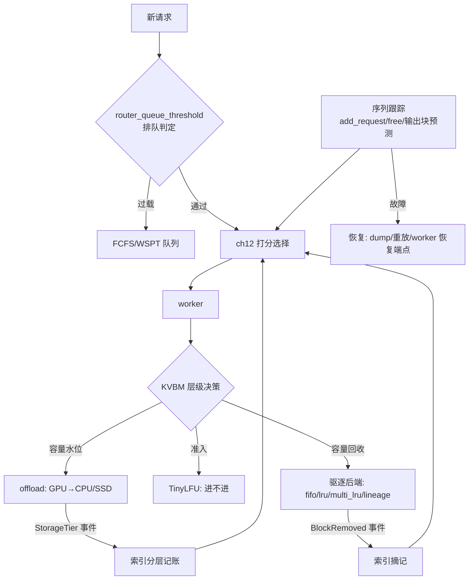

# 第 13 章 · 调度、驱逐与序列跟踪（源码深读版）

> **适合谁读**：深入路由与容量管理的读者；这一章把第三部分收口。
> 初学者先读 13.0 人话版。**前置**：ch10–ch12。
> **耗时**：55 分钟（人话版 8 分钟，源码 47 分钟）
> **源码锚点**：commit `61e9184`（v1.5.0）。

**学完能：**
- 用餐厅类比说清"排队派单挑平均还是保尾部"和"准入与驱逐是两个决策"
- 解释 FCFS vs WSPT 两种队列策略各自优化的目标函数，知道何时切换
- 说出路由侧序列跟踪记账的四个开关及其默认值、各自换什么
- 区分"路由侧 TTL 记账"与"KVBM 驱逐后端"两级驱逐，并按行为选后端

---

## 13.0 人话版：高峰期的餐厅怎么运转（零代码）

餐厅类比收尾。本章回答三个高峰期的运营问题：

**① 单子太多，先做哪单？**（路由队列）两种朴素哲学：按到店顺序做
（FCFS）——先来的客人绝不插队，排队体验稳定，但一个巨大的订单会把
后面所有小单压住；小单先做（WSPT）——平均等待最好，但大单可能等到
天荒地老。**没有对错，只有你的 SLO 写的是什么**：写 P99（尾部不超时）
选 FCFS，写 P50（平均快）选 WSPT。更进一步：如果所有厨师都忙到头了，
新单子先挂队列（`router_queue_threshold`），而不是硬塞给最不忙的那个
——这是背压。

**② 领班手里那本"在途账"记什么？**（序列跟踪）哪些客人已入座、哪桌
还在等上菜（prefill 未完成）、每桌预计还要占多少盘子（输出块预测）。
关键洞察：**生成中的客人盘子数是一直涨的**，只看"现在几个盘子"会系统
性低估长对话的占地——所以要按生成进度向预计总量插值，让派单看到
"将来会占多少"，而不是"现在占多少"。

**③ 冰箱满了，扔什么备菜？**（驱逐）两个独立的决策：**新备菜要不要
进冰箱**（准入，TinyLFU 频率门槛——偶尔被点一次的菜不值得占冰箱）和
**冰箱满了扔谁的**（驱逐）。驱逐策略里最适合餐厅（对话）的是看"谱系"：
多轮对话的**祖先块**（这桌客人大概率还会追加，前缀还要用）保住，
**叶子块**（上次输出的尾巴，基本不会再用）先扔——纯 LRU 做不到这点，
一遍新客扫描就能把老主顾的备菜全冲掉。扔了备菜，厨师会喊话
（BlockRemoved），领班账本跟着划掉（ch10-ch11 的闭环），下次派单重新
洗牌——**驱逐决策其实是在改写未来的路由输入**。

> **面试 60 秒开场**（被问"缓存满了怎么办/调度怎么设计"时）：
> "分两级：路由侧只做记账——没开 KV 事件时用 TTL 兜底过期，真驱逐在
> worker 侧的 KVBM。驱逐分两个正交决策：TinyLFU 管准入（新块进不进），
> fifo/lru/multi_lru/lineage 管驱逐（扔谁）；对话负载用 lineage 最优，
> 因为链接哈希天然编码了序列家谱，能区分'还会被追问的前缀'和'一次性的
> 输出尾块'。队列上 FCFS 保 P99、WSPT 保平均，看 SLO 选。"完整追问链
> 见面经 Q10-Q12，展开在 13.1-13.4。

## 13.1 路由队列：FCFS vs WSPT

ch12 的调用链里，`find_best_match` 之前请求要先过路由内建的调度队列
（`SchedulerQueueActor`——公式日志注释里提过，打分在这个 actor 任务里执行）。
策略由 `router_queue_policy` 选择（`scheduling/config.rs:454`）：

| 策略 | 算法 | 优化目标 | 备注 |
|------|------|----------|------|
| `fcfs`（默认） | 先来先服务 + 优先级加塞（`priority_jump`/`strict_priority`，ch12 输入） | **尾部 TTFT**（P99） | 长请求不会饿死，但平均等待差 |
| `wspt` | 加权最短处理时间（Smith's rule）：按 `处理时间/权重` 升序 | **平均 TTFT** | 调度论经典结论 |

> Smith's rule 是单机调度里 `ΣwⱼCⱼ`（加权完成时间和）的最优解。映射到
> 推理：短请求优先 → 平均 TTFT 下降；代价是长请求尾部变差。选哪个取决于
> 你的 SLO 写的是 P50 还是 P99。配置注释原话：*"fcfs … optimizes tail TTFT.
> wspt … optimizes average TTFT."*

**排队触发条件**是 `router_queue_threshold: Option<f64>`（默认 `None` =
不排队，直接全走 ready）：设为 0.6 表示"所有候选 worker 的 prefill token
水位都超过其 `max_num_batched_tokens` 的 60%"时请求进入队列而不是硬塞给
最不忙的那个。配合 ch12 的 `QueueRejected` 出口，这是过载背压的第一道闸。

## 13.2 序列跟踪：路由的"在途账本"

`KvRouter` 上的一组方法（`lib/llm/src/kv_router.rs:1862-1978`）就是账本的
借贷方向：

```rust
pub async fn add_request(&self, ...)                       // 请求被接受：登记在途
pub async fn mark_prefill_completed(&self, request_id)     // prefill 完成（分离接力点）
pub async fn free(&self, request_id)                       // 请求结束：释放
pub async fn free_if_worker(&self, ...)                    // 仅当仍在原 worker 时释放（防误释放迁移后的序列）
pub fn pending_count(&self) -> usize                       // 在途数
pub fn pending_isl_tokens(&self) -> usize                  // 在途输入 token 数
```

底层结构在 `lib/kv-router/src/sequences/`：`single.rs`（`ActiveSequences`，
聚合视角单段跟踪）、`multi_worker.rs`（分离模式两段跟踪）、`block_tracker.rs`
（块级）、`prompt_registry.rs`、`prefill_tracker.rs`（等待接力的 prefill 完成
序列——ch14 的对接面）、`replica_sync.rs`（多路由副本间的账本同步，
`router_replica_sync` 控制）。

四个记账开关（默认值见 `config.rs` Default impl）：

| 开关 | 默认 | 语义 |
|------|------|------|
| `router_track_active_blocks` | true | 路由侧跟踪活跃块（`DYN_ROUTER_TRACK_ACTIVE_BLOCKS`） |
| `router_track_prefill_tokens` | true | 在途 prefill token 计入负载（ch12 衰减公式吃的就是这个数） |
| `router_track_output_blocks` | false | 生成期占位块跟踪：随输出推进按 `agent_hints.osl` 做**分数衰减**——预测"这条请求最终会占多少 KV" |
| `router_assume_kv_reuse` | true | true=算真实块哈希；false=**随机哈希**（假设完全无复用，用于对照实验/无前缀负载下省哈希开销） |

`router_track_output_blocks` 的思路值得咀嚼：decode 请求的 KV 占地是**持续
增长**的，只看当前块数会系统性低估长生成请求。按输出进度向目标 osl 插值
（fractional decay），让打分看到"将来会多大"。这与 KVBM 的 lineage 驱逐
（13.4）构成同一思想在两端的实现：一个预测未来占地，一个尊重历史价值。

**恢复**：`dump_events()`（`kv_router.rs:2237`）+ ch11 的
`dump_tree_as_events()`——账本与索引都可导出重放；worker 侧还有 ch10 的
恢复端点。`tests/fault_tolerance/` 验收这些路径。

## 13.3 路由侧的"软驱逐"：TTL 记账

没有 KV 事件时（`use_kv_events=false`），索引里的块记录靠
`router_ttl_secs`（默认 **120.0** 秒）过期——纯时间衰减的乐观记账。
有 KV 事件时（默认路径），块的生灭由事件驱动，TTL 不参与——
**"驱逐"的真相在 worker 侧**，路由只是记账员。

## 13.4 worker 侧驱逐：KVBM 后端

真正扔 KV 的是 `lib/kvbm-logical/src/pools/inactive/backends/`：

```
backends/
├── fifo.rs               # 先进先出
├── lru_backend.rs        # LRU
├── multi_lru_backend.rs  # 多队列 LRU（分代）
├── hashmap_backend.rs    # 简单池
├── lineage/eviction.rs   # 谱系感知驱逐
└── reuse_policy.rs       # 复用策略
```

三个层次的选择逻辑：

1. **FIFO/哈希池**：测试与语义最简场景。
2. **LRU 家族**：按最近命中。`multi_lru` 是分代变体（近似"新宠/旧爱"分队列，
   抗扫描污染——一遍顺序扫描不会把热前缀全冲掉）。
3. **lineage（谱系）**：利用序列家谱（ch11 的链接哈希天然编码了"这块从哪条
   序列分叉"）：多轮对话的**祖先块**（大概率被下一轮命中）保，**叶子块**
   （一次性输出尾块）先扔。这是对话型负载相对纯 LRU 的关键增益。

守门员是 `lib/kvbm-logical/src/tinylfu.rs`（TinyLFU 风格的**准入**而非驱逐）：
新块想进缓存先过频率门槛——**"让不让他进来"和"把谁扔出去"是两个正交
决策**， TinyLFU 准入 + LRU/lineage 驱逐组合使用。索引侧的对应物是
`ApproximateCachePolicyKind`（`router_approximate_cache_policy`）与
`KvIndexer::new_with_approximate_retention(...)`——路由索引的容量管理。

> **驱逐即路由**：现在你能精确说出这条因果链了——
> 驱逐后端决定哪些块消失 → `BlockRemoved` 事件 → 索引摘记 → 下一次
> `find_matches` 的 overlap 变小 → 打分重新洗牌。换驱逐策略 = 隐式改写
> 未来所有请求的打分输入。

## 13.5 两级驱逐全景



与入门视角相比，这里新加入的两块拼图：排队判定（13.1）和准入 vs 驱逐的分离（13.4）。

## 13.6 配置速查（本章相关）

| 旋钮 | 默认 | 环境 | 章 |
|------|------|------|----|
| `router_queue_policy` | fcfs | `DYN_ROUTER_QUEUE_POLICY` | 13.1 |
| `router_queue_threshold` | None（不排队） | `DYN_ROUTER_QUEUE_THRESHOLD` | 13.1 |
| `router_ttl_secs` | 120.0（仅无事件模式） | `DYN_ROUTER_TTL_SECS` | 13.3 |
| `router_track_*` 四开关 | 见 13.2 表 | `DYN_ROUTER_TRACK_*` | 13.2 |
| `router_replica_sync` | false | `DYN_ROUTER_REPLICA_SYNC` | 13.2 |

## 13.7 故障收口：一个 worker 挂了会发生什么

这一节把第三部分的知识串成一条时间线——它同时是面经 Q17 的源码版。
按四波展开（`lib/llm/src/migration.rs`、发现层、索引侧联动）。

**第一波（秒级）：三条独立通道各自检测、各自摘除。** 没有中心化的
"故障管理器"，worker 死掉时它持有的三样东西同时断——请求平面的流、
ZMQ 事件源、etcd lease 心跳——三个消费者各管各的：

1. **服务发现（etcd lease）**：worker 注册时 MDC、endpoint、`EventSource`
   全挂在 lease 上（`registration.rs:64-114`）。进程死 → 心跳停 → lease
   到期 → etcd 自动删键 → 前端/路由的 watch 收到 Deleted：
   `watcher.rs:1202-1233` 发 `ModelUpdate::Removed` 摘除 worker_set，
   负载表同步移除（`metrics.rs:460 remove_worker`）——它不再是打分候选。
2. **事件面**：EventSource 随 lease 消失，KV 事件流自然断流。没有
   "注销广播"，键没了就是没了。
3. **请求平面**：投递给它的在途请求流断开/报错——引出第二波。

**索引侧的清除：不是靠 KV 事件，也不能靠。** 死 worker 不会再发任何
事件，所以摘除由发现层 Deleted 直接触发。对照两组 API（ch11）：

| API | 触发源 | 语义 |
|-----|--------|------|
| `clear_all_blocks(worker_id)`（`radix_tree.rs:685`） | KV 事件 `Cleared` | worker 活着，主动清自己的账 |
| `remove_worker`（`:665`）/ `remove_worker_dp_rank`（`:669`） | **发现层 Deleted** | worker 死了/注销，摘除持有标注 |

`remove_worker` 的粒度要分清：**摘"持有标注"，不删节点**
（`prompt_membership_trie.rs:51-58` 从每个节点摘
`full_edge_workers`/`worker_cutoffs` 里这个 worker 的记录）——公共前缀
节点可能同时被多个 worker 持有，摘掉死者、活人的共享前缀原样保留；摘完
后无任何 worker 持有的空节点交给修剪机制（近似 LRU）回收。

为什么必须摘、且不能用"尽力而为"兜底：平时索引多记无害的前提是
worker 还活着（未命中重算）。worker 挂了缓存随进程消失，索引不摘的话
路由会持续认为它"缓存最热"、**持续把请求派给死进程**。所以发现层摘除
是**正确性相关**的强一致操作——这也是它挂在 etcd lease 而不是事件流上
的原因。NATS 上已发出去的事件不用清（事件平面不存历史，消费即弃），
真正被维护的是索引状态。worker 重启回来则是**新的临时 worker_id**
（`stable_routing_id` 的文档注释："survive a new ephemeral `worker_id`"），
旧 id 记录已摘、新 id 从零记账，互不污染。

**第二波：在途请求迁移而非报错（in-flight fault tolerance）。** 前端的
`RetryManager`（`migration.rs:373 next()`）盯着响应流：

- 流报错 → `is_migratable_for_request`（`:93`）判定：错误类型可迁移且
  **请求没被显式 pin**（分离接力 pin 的语义优先于迁移）；
- 迁移 = `new_stream`（`:418`）**重建流**：重走 ch12 路由，带三样东西——
  **失败排除表** `migration_state.excluded_worker_ids()`
  （`kv_selection.rs:209-225` 白名单硬过滤，不选回刚挂的 worker）；
  **已完成进度** `completed_tokens`（新 worker 把已生成部分当作 prompt
  重新 prefill 再继续 decode，客户端的流无缝续上）；
  **`migration_link`**（OTel 链接，新尝试的 span 链回失败 worker 的 span）；
- 上限是 MDC 的 `migration_limit`（13.2 提过，0=禁用）——耗尽则
  `record_migration_exhausted`，错误返回客户端；
- 序列账本配套 `free_if_worker`（13.2）：只在请求仍在原 worker 时释放，
  防止把已迁移请求的账划错。

索引摘除、负载摘除、迁移排除是**三重保险**：前两个管"新请求别去"，
第三个管"旧请求别回头"。

**客户端视角**：迁移成功则流式输出无缝继续（代价是新 worker 重新
prefill，TTFT 上升）；迁移耗尽或请求被 pin 则错误返回。

**第三波（分钟级）：K8s 重建。** operator 重建 pod → 新 worker 注册新
MDC、**新 publisher_id**（生死耦合干净开局）。两个预期行为别误判为故障：
新 worker 的 KV 缓存是空的，本地索引恢复端点也帮不上忙（快照为空），
overlap=0、靠负载项逐步吸引请求，**命中率短暂下降是设计内行为**；若该
worker-set 的 `needs` DNF 依赖因此不满足（如 prefill 池唯一的 decode 伙伴
没了），就绪门会拒绝为新流量背书。

## 面试指引：本章能答什么

完整问答与追问链见[面经-Dynamo](../面经-Dynamo.md) **Q10**（队列策略）、
**Q11**（驱逐体系）、**Q12**（在途跟踪与长请求占地）、**Q17**（worker
挂了发生什么——13.7 是它的源码级完整版）。

章内补充问法（面经未展开、答上就是加分项）：

1. **"驱逐和路由什么关系？"** → 要点：驱逐后端决定哪些块消失 →
   BlockRemoved 事件 → 索引摘记 → 下次 overlap 变小 → 打分重洗牌——
   换驱逐策略等于隐式改写所有未来请求的路由输入，是一根隐藏杠杆。
2. **"准入（admission）和驱逐（eviction）为什么要分成两个决策？"** →
   要点： TinyLFU 管"进不进"（频率门槛，防一次性块挤占），驱逐后端管
   "扔谁"；正交组合才能同时抗扫描污染和保留热前缀——只调一边会顾此
   失彼。
3. **"P50 和 P99 打架怎么办？"** → 要点：先问 SLO 谁说了算；工程上
   FCFS 保尾部是默认，WSPT 是拿尾部换平均；也可谈队列阈值做分区
   （大单小单分池）这类延伸思路，展示你理解这是目标函数选择而非
   技术对错。

## 小结

- 一句话：忙不过来先挂单（挑平均还是保尾部看 SLO）；账本要记"将来
  会占多少"；冰箱管理 = 准入和驱逐两个正交决策，对话负载靠谱系。
- worker 挂掉 = 四波时间线：lease 摘除（索引/负载）→ 在途请求迁移
  （排除表+进度重放+migration_link）→ 三重保险 → 新 worker 新身份从零。
- 队列：fcfs 保尾部 / wspt 保平均，`router_queue_threshold` 是背压第一闸。
- 账本：`add_request → mark_prefill_completed → free` 生命周期 + 四个记账
  开关；输出块预测让打分看到"未来占地"。
- 驱逐两级：路由侧 TTL 只是无事件模式的兜底；真驱逐在 KVBM——准入
  （TinyLFU）与驱逐（fifo/lru/multi_lru/lineage）正交组合。

## 自检（8 题，自答）

1. SLO 是 P99 TTFT，用 fcfs 还是 wspt？如果产品经理同时要 P50 呢？
2. `router_queue_threshold=0.0` 与 `None` 的行为差异？
3. `router_track_output_blocks=false` 时，长生成请求在打分里被如何系统性
   误判？方向是什么？
4. TinyLFU 是驱逐策略吗？它和 lru_backend 是什么关系？
5. `free_if_worker` 为什么要带 worker 条件？联系 ch14 的迁移场景回答。
6. 设计一个实验证明"lineage 优于 LRU"：负载怎么构造、看什么指标？
7. worker 挂掉后，路由索引里它的记录靠什么清除？为什么不能等 KV 事件？
   `remove_worker` 摘的是节点还是持有标注——为什么这样设计？
8. 在途请求迁移时带上哪三样东西？migration_limit 耗尽后客户端看到什么？
   被显式 pin 的请求为什么不迁移？

## 下一步（跳转推荐）

- → [ch14 PD 分离架构](../04-disagg/ch14-pd-disagg.md)（`prefill_tracker`
  的另一半故事）
- → [ch16 KVBM](../04-disagg/ch16-kvbm.md)（13.4 的完整展开）
