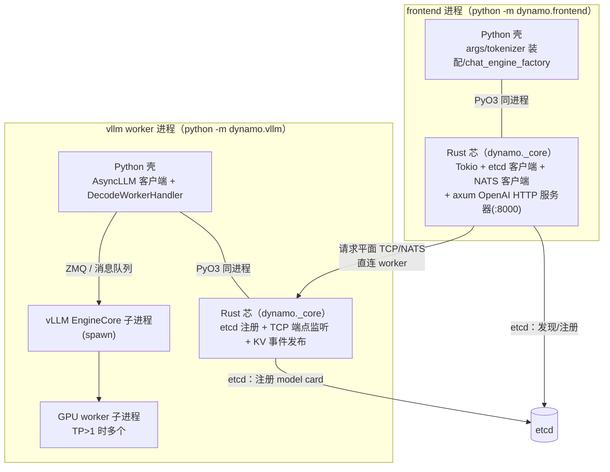
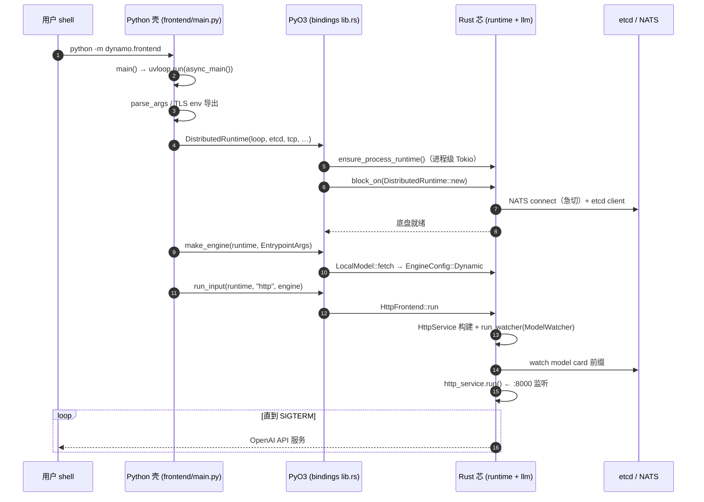
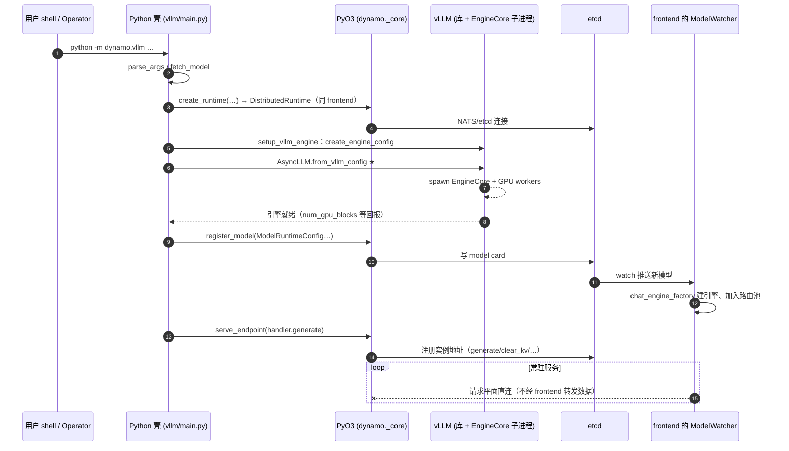

# 第 27 章 · 启动链路：一条命令如何变成一个服务

> **适合谁读**：所有读者。ch09 讲"一次请求的旅程"，本章讲"一个进程的旅程"——
> 二者互为姊妹篇，建议连读。
> **前置**：ch03、ch06、ch09。
> **耗时**：60 分钟
> **源码锚点**：commit `61e9184`（v1.5.0）。本章所有行号均在该 commit 上核验过。

**学完能：**
- 逐层说清 `python -m dynamo.frontend` 如何在一个 Python 进程里"长出"一个 Rust
  HTTP 服务器（etcd/NATS/Tokio/axum 各在哪一步就位）
- 逐层说清 `python -m dynamo.vllm` 如何把 vLLM 引擎**以库的方式**组装进进程、
  再把自己注册到 etcd 让 frontend 发现
- 回答面试高频题："Dynamo 的 Rust 和 Python 是怎么配合的？是两个进程吗？"

---

## 27.1 先破一个误解：Rust 服务不是被"拉起来"的

**Dynamo 1.5 里没有任何独立的 Rust 守护进程。** 你敲下 `python -m dynamo.frontend`
之后，不会 spawn 出一个 "dynamo-server"；Rust 核心（Tokio 异步运行时、etcd 客户端、
NATS 客户端、TCP 服务、axum HTTP 服务器）全部编译成一个 PyO3 原生扩展
**`dynamo._core`**，直接嵌在**同一个 Python 进程**里运行。这就是贯穿全书的那句
"Python 壳 + Rust 芯"的确切含义。

模块名在构建配置里写死：

```
lib/bindings/python/pyproject.toml:49
    module-name = "dynamo._core"
```

这个 crate（`lib/bindings/python`，用 maturin 构建，刻意不在 Cargo workspace 里）
暴露的 Python 包分两层：

```
你的进程
 ├─ components/src/dynamo/…        ← 上层组件：frontend、vllm、sglang、mocker…
 │    （业务逻辑、引擎适配，纯 Python）
 ├─ lib/bindings/python/src/dynamo/
 │    ├─ runtime/__init__.py       ← 薄再导出层：
 │    │    from dynamo._core import DistributedRuntime …
 │    └─ llm/__init__.py           ← 同样是再导出层：make_engine、run_input、
 │         register_model、KvEventPublisher… 全部来自 dynamo._core
 └─ dynamo._core（原生扩展 .so/.pyd）
      └─ lib/bindings/python/rust/…（PyO3）→ lib/runtime、lib/llm 等 Rust crate
```

所以 `from dynamo.runtime import DistributedRuntime` 拿到的就是 Rust 对象，
调用它的方法 = 跨过 PyO3 边界进入 Rust——但没有跨进程、没有跨网络。

两类进程的拓扑对照：



注意最后一条：frontend 与 worker 之间**没有中心代理**，发现靠 etcd，流量走请求
平面直连。frontend 从不"调用起来" worker，它只是**发现** worker（ch08）。

---

## 27.2 frontend 启动链：`python -m dynamo.frontend` 的十二步

### 27.2.1 调用树总览

```
python -m dynamo.frontend
 └─ components/src/dynamo/frontend/__main__.py        # 仅 7 行
     └─ frontend/main.py :: main()                    # 495 行
         ├─ _raise_fd_limit()                         # RLIMIT_NOFILE 提到 8192
         └─ uvloop.run(async_main())                  # 355 行
             ├─ parse_args() → FrontendConfig         # --http-port(默认 8000) 等
             ├─ _export_transport_tls_env(config)     # 393 行：必须在 runtime 之前！
             ├─ DistributedRuntime(loop, …)           # 394 行 —— PyO3 边界
             │   └─ lib/bindings/python/rust/lib.rs :: new()      # 1162 行
             │       ├─ Worker::ensure_process_runtime()          # 进程级 Tokio
             │       └─ block_on(rs::DistributedRuntime::new(…))
             │           └─ lib/runtime/src/distributed.rs :: new()   # 172 行
             │               ├─ NATS client.connect()             # 急切连接
             │               ├─ etcd / K8s / file / memory 发现后端
             │               ├─ SystemHealth + 系统状态服务
             │               └─ NetworkManager（请求平面）
             ├─ make_engine(runtime, EntrypointArgs(EngineType.Dynamic, …))  # 470 行
             │   └─ lib/bindings/python/rust/llm/entrypoint.rs :: make_engine  # 736 行
             │       ├─ LocalModel::fetch（拉分词器/模型卡）
             │       └─ select_engine → EngineConfig::Dynamic{ chat_engine_factory }
             └─ await run_input(runtime, "http", engine, …)       # 481 行
                 └─ lib/llm/src/entrypoint/input.rs :: run_input… # 109 行
                     └─ entrypoint/input/http.rs :: HttpFrontend::run
                         ├─ HttpService::builder().port(8000)…    # axum 服务
                         ├─ run_watcher(…)                        # 219 行
                         │   └─ ModelWatcher：订阅 etcd 里的 model card
                         └─ http_service.run(primary_token).await # 287 行 ← 此刻才监听端口
```

### 27.2.2 逐步详解

**① `__main__.py`：入口薄得像纸。**
`frontend/__main__.py` 只做一件事：`from dynamo.frontend.main import main` 然后调用
（`__main__.py:4-7`）。文件头注释（`main.py:4-13`）概括了这个进程要跑的四样东西：
OpenAI HTTP 服务器、etcd 自动发现、预处理器（模板+分词）、路由器（默认
round-robin，`--router-mode` 可换 kv/least-loaded 等）。

**② `main()`：uvloop 起事件循环。**
`main.py:495-498`。先 `_raise_fd_limit()`：高并发下 TCP accept 会撞上默认 1024 的
软 `RLIMIT_NOFILE`（EMFILE），这里尽力提到 8192（`DYN_FRONTEND_FD_LIMIT_TARGET`
可覆盖，非正值禁用）。然后 `uvloop.run(async_main())`——此后整个进程共享这一个
(uv)asyncio 事件循环，Rust 侧也会拿到它的引用（第⑤步）。

**③ `parse_args()`：一份配置，三种旗标。**
`main.py:243-317`。`FrontendArgGroup` 解析 dynamo 自己的旗标；剩下的 unknown 参数
按 `--chat-processor` 分派：`vllm` 时用 vLLM 原生 `FlexibleArgumentParser` 吞掉
vLLM 旗标（仅借用其解析器做 chat 前后处理，不建引擎——`main.py:278-290` 还特意
把无 GPU 主机上的平台探测强制成 CPU）；`sglang` 同理；都不匹配则报错退出。

**④ `_export_transport_tls_env`：一个容易踩的顺序坑。**
`main.py:320-352` 把 TCP/NATS 的 TLS 旗标导出成环境变量，**必须在构造
`DistributedRuntime` 之前执行**——注释写得很明白：runtime 构造时会**急切地连上
NATS**，之后再设 NATS 的 (m)TLS 变量会被静默忽略（TCP 平面是懒连接，无此问题）。

**⑤ `DistributedRuntime(loop, …)`：跨过 PyO3 边界。**
`main.py:394-400` 传入 `discovery_backend`（默认 etcd）、`request_plane`（默认
tcp）、`event_plane`、`response_plane`。Python 构造函数直接落在
`lib/bindings/python/rust/lib.rs:1162` 的 `#[new] fn new()` 上，它做三件事：

1. 解析后端与平面：`"kubernetes"` → K8s 发现，其余解析成 `KvStore` 选择器
   （`etcd://…`、`file://…`、`memory`），`lib.rs:1184-1190`；
2. `rs::Worker::ensure_process_runtime()`（`lib.rs:1200`，实现在
   `lib/runtime/src/worker.rs:125`）——拿到/创建**进程级 Tokio 运行时**（线程数由
   `DYN_RUNTIME_*` 控制），并把 pyo3 的 async 桥（`pyo3_async_runtimes`）指到它：
   此后 Rust future 与 Python asyncio 通过 `future_into_py` 互转，await 一个 Rust
   async 函数不会卡住 GIL（`lib.rs:1197-1218` 的注释解释了 sglang 场景下桥可能
   已被占用，属预期）；
3. `runtime.secondary().block_on(rs::DistributedRuntime::new(…))`（`lib.rs:1242`）。

**⑥ Rust 核心 `DistributedRuntime::new`：基础设施在此就位。**
`lib/runtime/src/distributed.rs:172-319`，按顺序：

- **NATS**：若启用（请求平面 nats、或事件平面 nats、或设了 `NATS_SERVER`），
  `nc.connect().await` 立即连接（`distributed.rs:180-183`）——这就是第④步顺序坑的
  根源；
- **发现后端**（`distributed.rs:207-242`）：K8s 走 `KubeDiscoveryClient`；
  `etcd://` 走 `etcd::Client::new`（连不上时的报错就是你见过的
  *"Could not connect to etcd. Pass `--discovery-backend ..` to use a different
  backend or start etcd."*）；`file://`/`memory` 是本地测试后端；
- **SystemHealth 与系统状态服务**：健康/指标的小 HTTP 服务（worker 侧
  `DYN_SYSTEM_PORT`；frontend 启动时特意 `pop` 掉这个变量避免抢端口，
  `main.py:367`）；
- **NetworkManager / EndpointRegistrationManager / metrics registry**：请求平面
  管理与端点注册的基础设施（`distributed.rs:244-280`）。

到这里，"Rust 服务"的全部底盘已经在你的 Python 进程里跑起来了。

**⑦ 装配 Python 侧的引擎工厂。**
回到 `async_main()`：注册 SIGTERM/SIGINT 的优雅退出（`main.py:402-406`）；
`build_router_config`（`main.py:412`，与 worker 侧共享同一构造器，保证双方语义
一致）；若 `--chat-processor vllm/sglang`，构造
`EngineFactory().chat_engine_factory`（`main.py:452-464`）——这个工厂后面会在
Rust 里被回调，为每个发现的模型建 Python 前后处理管线。

**⑧ `make_engine`：把参数变成 `EngineConfig`。**
`main.py:469-470` → PyO3 `make_engine`（`entrypoint.rs:736`）。先 `LocalModel::fetch`
把模型/分词器落到本地（Mocker 可只要分词器不要权重），再 `select_engine`：
`EngineType::Dynamic` 分支（`entrypoint.rs:872-906`）产出的只是
`EngineConfig::Dynamic { model, chat_engine_factory, prefill_load_estimator }`——
**此刻还没有任何真实推理引擎**，真实引擎要等 watcher 发现 worker 后由
`chat_engine_factory` 惰性创建。Python 工厂被
`py_engine_factory_to_callback`（`entrypoint.rs:799`）包成 Rust 回调：每次调用时
拿 GIL、把 coroutine 转成 future、await、再取出 `PythonAsyncEngine`——这是
"Rust 主干 + Python 插件"的关键一跳。

**⑨-⑫ `run_input`：HTTP 服务器与 etcd 监视。**
`main.py:481` → PyO3 `run_input`（`entrypoint.rs:1003`）→
`lib/llm/src/entrypoint/input.rs:109` 按 `Input::Http` 分派到
`entrypoint/input/http.rs:127` 的 `HttpFrontend::run`：

- 用 `HttpService::builder()` 配端口（默认 8000）/host/TLS/指标
  （`http.rs:149-194`）——HTTP 服务器本体是 **Rust axum**，承载全部 OpenAI 兼容
  路由（`lib/llm/src/http/service/openai.rs`，见 ch09）；
- `EngineConfig::Dynamic` 分支调用 `run_watcher(…)`（`http.rs:219`，定义在
  `http.rs:307`）→ 启动 **ModelWatcher**（`lib/llm/src/discovery/watcher.rs`），
  持续 watch etcd 里的 model card 增删；每发现一个 worker 注册的模型，就调用
  `chat_engine_factory` 建引擎并挂到 HTTP service 上（ch08 详述）；
- 最后 `http_service.run(distributed_runtime.primary_token()).await`
  （`http.rs:287-289`）——**端口在这一刻才真正监听**。此函数不返回，进程就此
  常驻；收到 SIGTERM 时 `graceful_shutdown` → `runtime.shutdown()` 取消主
  cancel token，一切随之收尾。

### 27.2.3 时序图



---

## 27.3 worker 启动链：`python -m dynamo.vllm` 怎么"调用起来 vLLM"

**第二个要破的误解：worker 不是用命令行拉起一个 `vllm serve` 子进程。**
vLLM 是被当作 **Python 库** import 进来、在 worker 进程内组装的；真正被 spawn 出来
的是 vLLM 自己的 EngineCore 子进程。Dynamo 负责的是：把组装好的引擎包装成
endpoint、写进 etcd、在请求平面上服务。

### 27.3.1 调用树总览（以 decode/aggregated 主路径为例）

```
python -m dynamo.vllm
 └─ components/src/dynamo/vllm/__main__.py           # PYTHONHASHSEED=0；快照待命检查
     └─ vllm/main.py :: main()                       # 1012 行
         └─ uvloop.run(worker())                     # 160 行
             ├─ parse_args → Config                  # dynamo 旗标 + 透传 vLLM 旗标
             ├─ fetch_model(config.model)            # 199 行：先落盘再起 vLLM
             ├─ [快照模式 / headless 模式分叉]
             ├─ create_runtime(…)                    # 225 行 → 同一个 PyO3 构造
             └─ WorkerFactory(…).create(runtime, …)  # 248-263 行
                 └─ worker_factory.py :: _run_decode_worker     # 1182 行
                     ├─ runtime.endpoint("ns.comp.generate") 等  # 只建引用，不监听
                     ├─ setup_vllm_engine(config, …)  # vllm/main.py:585
                     │   ├─ engine_args.create_engine_config() → VllmConfig
                     │   └─ AsyncLLM.from_vllm_config(…)         # 747 行 ★起 vLLM
                     │       └─（vLLM 内部）spawn EngineCore 子进程 + GPU workers
                     ├─ DecodeWorkerHandler(engine_client, …)   # handlers.py
                     ├─ KV publisher / FPM relay / metrics（可选）
                     ├─ register_vllm_model(…) → register_model  # 写 etcd ★被发现
                     │   # main.py:807 组装 ModelRuntimeConfig，:938 落 etcd
                     └─ asyncio.gather(
                          generate_endpoint.serve_endpoint(handler.generate, …),
                          clear_kv_blocks / get_perf_metrics [/rl /lora…])
                          # PyO3 lib.rs:1445：PythonAsyncEngine → etcd 实例注册
                          # + TCP/NATS 监听
```

### 27.3.2 逐步详解

**① `__main__.py`：两个特殊动作。**
`vllm/__main__.py:6-7` 先设 `PYTHONHASHSEED=0`（DP 各 rank 哈希一致）；再调
`maybe_run_restore_standby_mode()`——快照恢复的"待命模式"必须在 import vLLM 之前
拦住进程（CRIU 捕获 GPU 状态时不能有引擎状态），普通启动下是空操作。

**② `worker()`：与 frontend 同构的开场。**
`main.py:1012` → `uvloop.run(worker())`。`parse_args` 产出 `Config`
（`args.py`：dynamo 旗标 + 原样透传给 vLLM `AsyncEngineArgs` 的旗标，所以你在
worker 命令行上看到的 `--max-model-len` 等都是 vLLM 的）；随后
`fetch_model`（`main.py:198-199`）用 Dynamo 的通用取模型路径先把权重落盘，避免
vLLM 启动中途去 HuggingFace 下载。

**③ 三个分叉，早于 runtime。**
快照/checkpoint 模式（`main.py:203-215`，先建引擎再建 runtime，保证 CRIU 捕获时
无网络连接）；**headless 模式**（`main.py:217-221` → `headless.py`）整个绕过
`DistributedRuntime`——不连 NATS/etcd、不注册端点，纯 vLLM，用于直接压测引擎；
正常路径继续。

**④ `create_runtime`：与 frontend 第⑤步完全相同。**
`main.py:225-230` → `common/utils/runtime.py:45` → 同一个 PyO3 `DistributedRuntime`
构造函数。frontend 与 worker 在"Rust 芯"层面没有任何区别，区别全在 Python 壳
装配了什么。

**⑤ `WorkerFactory.create`：按角色分派。**
`worker_factory.py:707` 依配置分派：realtime → embedding → classify →
encode（多模态）→ prefill → decode/aggregated（`config.disaggregation_mode`，
见 ch14）。以下沿最常用的 decode/aggregated 路径（`_run_decode_worker`，
`worker_factory.py:1182`）。

**⑥ `runtime.endpoint(…)`：只是引用。**
`worker_factory.py:1193-1230` 创建 `generate`、`clear_kv_blocks`（以及可选的
`rl`、`load_lora` 等）端点对象。注意此刻**什么都没监听**——`endpoint()` 只是
`ns.component.name` 三段名的引用（bindings `lib.rs:1266-1295`），监听发生在第⑨步
的 `serve_endpoint`。

**⑦ `setup_vllm_engine`：vLLM 在这里被"调用起来"。**
`vllm/main.py:585-804`：

- 环境准备：`PROMETHEUS_MULTIPROC_DIR`、`VLLM_NO_USAGE_STATS=1`、
  **`VLLM_WORKER_MULTIPROC_METHOD=spawn`**（`main.py:633-634`）；
- `engine_args.create_engine_config(usage_context=OPENAI_API_SERVER)`
  （`main.py:674`）→ 完整 `VllmConfig`（此刻完成 vLLM 全部配置校验，含 KV
  connector 等 Dynamo 注入项，见 ch17）；
- **`AsyncLLM.from_vllm_config(vllm_config, …)`（`main.py:747-753`）**——这一行
  就是"起 vLLM"。`AsyncLLM` 是 vLLM v1 的进程内异步客户端；vLLM 默认再 spawn
  出 **EngineCore 子进程**（调度循环所在），TP/DP 并行时 EngineCore 进一步拉起
  GPU worker 子进程。所以 worker 进程的进程树是：
  `python -m dynamo.vllm`（主：Dynamo runtime + AsyncLLM 客户端）→
  `EngineCore`（spawn）→ GPU workers。主进程与 EngineCore 之间的通信完全是
  vLLM 内部机制，Dynamo 不插手。

**⑧ 包装与旁路服务。**
`DecodeWorkerHandler`（`worker_factory.py:1284-1297`，实现在 `handlers.py`）把
`engine_client` 包成 `handler.generate` 这个 async generator——它就是将来挂在
endpoint 上的处理函数（ch17 详述 token 进出）。随后按需挂：KV 事件发布器
（`setup_kv_event_publisher`，`main.py:443`，每个 dp_rank 一个，从 vLLM 的 ZMQ
端点读 KV 事件再发到事件平面，见 ch10）、FPM 指标中继、Prometheus 采集。

**⑨ `register_vllm_model` → `register_model`：把自己写进 etcd。**
`worker_factory.py:1399` → `vllm/main.py:807-962`：组装 `ModelRuntimeConfig`
（`context_length`、`total_kv_blocks`、`max_num_seqs`、KV 事件开关、
`worker_type` 与 `needs` DNF、路由广告、LoRA 容量……全是从 `VllmConfig` 现查的真实
容量数字），最终 `await register_model(...)`（`main.py:938`）——PyO3 直达 Rust，
把 **model card** 写进 etcd。**frontend 的 ModelWatcher 看到的就是这张卡片**，
两条启动链在 etcd 上完成会师。

**⑩ `serve_endpoint`：从 Python 函数到网络端点。**
`worker_factory.py:1439-1484` 用 `asyncio.gather` 同时服务多个端点，主端点调用
`generate_endpoint.serve_endpoint(handler.generate, graceful_shutdown=True, …)`。
跨过 PyO3（`bindings lib.rs:1445`）后：先按函数签名判定 push/pull egress
（TRT-LLM worker 用 `@push_egress_capable` 走 push 通道，其余走 pull，即 Rust
逐个 `__anext__` Python 生成器）；随后把 Python 生成器包成 `PythonAsyncEngine`
→ 网络 ingress → `endpoint.serve()`：**在 etcd 注册实例地址，并开始监听请求平面**
（TCP 或 NATS）。此后 frontend 经由发现 + 直连把请求打进来（ch09 阶段⑤）。

### 27.3.3 时序图



---

## 27.4 两条链的对照表

| 维度 | `python -m dynamo.frontend` | `python -m dynamo.vllm` |
|------|------------------------------|--------------------------|
| 进程模型 | 单进程：Python 壳 + Rust 芯 | 主进程（Python 壳 + Rust 芯）+ vLLM EngineCore 子进程 + GPU worker 子进程 |
| Rust 芯负责 | Tokio、etcd/NATS 客户端、axum OpenAI HTTP(:8000)、路由器、聚合器 | Tokio、etcd 注册、请求平面监听、KV 事件发布 |
| Python 壳负责 | 旗标装配、chat_engine_factory（tokenizer/parsers 前后处理） | AsyncLLM 客户端、DecodeWorkerHandler、指标 |
| 引擎何时存在 | 惰性：watcher 发现 worker 后由工厂创建 | 主动：启动时 `AsyncLLM.from_vllm_config` |
| 写 etcd 的内容 | 自身实例/命名空间信息 | model card（容量、worker_type、needs、路由广告） |
| 监听端口 | `--http-port`（默认 8000），axum | 请求平面端点（generate 等），由 runtime 分配/注册 |
| 端口监听时刻 | `http_service.run()`（input/http.rs:287） | `serve_endpoint` 内的 `endpoint.serve()` |
| 退出路径 | SIGTERM → `graceful_shutdown` → `runtime.shutdown()` | 信号 handler → 端点优雅排空 → EngineCore shutdown |

## 27.5 谁先谁起？就绪怎么判定？

- **顺序无关**：两条链通过 etcd 解耦。worker 先起，卡片先写，frontend 后起时
  watcher 会追上存量卡片；frontend 先起，则等 watcher 增量发现。K8s 下 Operator
  只保证 Pod 编排，不保证就绪顺序（ch20）。
- **frontend 何时可服务**：`DYN_ROUTER_MIN_INITIAL_WORKERS`（由 `--min-initial-workers`
  设置，`frontend/main.py:408` 导出给 Rust）控制路由池最小初始 worker 数；
  分离部署还看 `needs` DNF——例如 decode 卡片声明 `[Prefill]`，P 不在线就不
  ready（`worker_factory.py:1384-1393`，详见 ch08/ch14）。
- **K8s 入口完全相同**：DGD 渲染出的 container command 就是
  `python -m dynamo.frontend` / 各后端镜像的 `python -m dynamo.*`，本章链条
  原样适用；区别只是发现后端换成 `kubernetes`。

## 27.6 常见误区（面试高频）

1. **"Dynamo 起了一个 Rust 服务进程"**——没有。Rust 是嵌在 Python 进程里的
   `dynamo._core` 扩展；一个组件一个进程，壳芯同体。
2. **"worker 用 subprocess 拉起 vllm serve"**——不是。vLLM 是 import 进来的库，
   `AsyncLLM.from_vllm_config` 进程内组装；被 spawn 的是 vLLM 自己的 EngineCore。
3. **"frontend 调用 worker"**——frontend 只在 etcd *发现* worker，数据面经请求
   平面直连 worker 端点；frontend 从不代理 token 流（ch09 阶段⑤⑥）。
4. **"dynamo serve"**——0.x 时代的入口，1.5 已不存在；现在的入口是
   `python -m dynamo.<component>`。网上大量资料停留在旧版。
5. **"NATS/etcd 断了也能起"**——构造 runtime 时两者都是急切连接，连不上直接
   启动失败（headless 模式除外）。TLS 相关环境变量必须在构造前导出（27.2.2 ④）。

## 27.7 调试切入点

| 想确认什么 | 去哪下断点/看日志 |
|-----------|------------------|
| frontend 的 runtime 何时建成 | `frontend/main.py:394`；Rust 侧 `distributed.rs:172`，日志搜 "Initializing KV store discovery backend" |
| HTTP 端口何时监听 | `lib/llm/src/entrypoint/input/http.rs:287` 前后；`RUST_LOG=dynamo_llm=debug` |
| worker 是否连上 etcd | 同上；连接失败会打印 "Could not connect to etcd…" |
| vLLM 引擎是否起来 | `vllm/main.py:747`（`from_vllm_config` 返回处）与 `:763` 的 "has been initialized" |
| model card 写了什么 | `vllm/main.py:938`（`register_model` 调用处），`etcdctl get --prefix` 对应命名空间 |
| 端点是否开始监听 | `worker_factory.py:1442`（serve_endpoint 调用）；Rust 侧 bindings `lib.rs:1445`，日志有 "serving endpoint with pull/push egress" |
| Rust 内部细节 | `RUST_LOG=dynamo_runtime=debug,dynamo_llm=debug`（Python 进程的环境变量即可） |

## 27.8 小结

- Dynamo 的启动模型是"**每个组件 = 一个 Python 进程 = Python 壳 + Rust 芯**"，
  Rust 经 PyO3 同进程嵌入，`dynamo._core` 是唯一的原生扩展。
- frontend 链：`__main__` → `main()/uvloop` → `DistributedRuntime`（Tokio + etcd +
  NATS 就位）→ `make_engine`（模型卡 + 惰性引擎工厂）→ `run_input` →
  HttpService( axum ) + ModelWatcher → 端口监听。
- worker 链：`__main__` → `worker()` → 同一 `DistributedRuntime` →
  `WorkerFactory` 分派 → `AsyncLLM.from_vllm_config`（vLLM 以库方式组装，EngineCore
  是 vLLM spawn 的子进程）→ `register_model` 写 etcd → `serve_endpoint`
  监听请求平面。
- 两条链在 etcd 上会师：worker 写卡片，frontend watch 卡片。先后顺序无关，
  readiness 由最小 worker 数与 `needs` DNF 决定。

## 27.9 自检

1. `dynamo._core` 是什么？为什么说"Dynamo 没有独立的 Rust 服务"？
2. frontend 启动时 NATS 为什么是急切连接？这带来哪个 TLS 顺序坑？
3. `ensure_process_runtime()` 建的是什么？Rust future 和 Python asyncio 怎么互操作？
4. `make_engine` 在 `EngineType::Dynamic` 下真的创建推理引擎了吗？真正的引擎
   什么时候才存在、由谁创建？
5. `AsyncLLM.from_vllm_config` 之后，worker 进程的进程树长什么样？EngineCore
   是谁 spawn 的？
6. `runtime.endpoint("ns.comp.generate")` 和 `serve_endpoint` 的区别是什么？
7. frontend 怎么知道 worker 上线了？卡片里哪些字段决定"可服务"？
8. headless 模式跳过了哪些步骤？适合什么场景？

## 27.10 下一步

- 想看发现与就绪细节 → ch08（ModelWatcher 与 worker 生命周期）；
- 想看请求进来之后的事 → ch09（一次 HTTP 请求的完整旅程）；
- 想看 vLLM 集成内部 → ch17（handler 与 KV connector）；
- 想看 K8s 如何编排这些入口 → ch20（Operator 与 DGD）。
